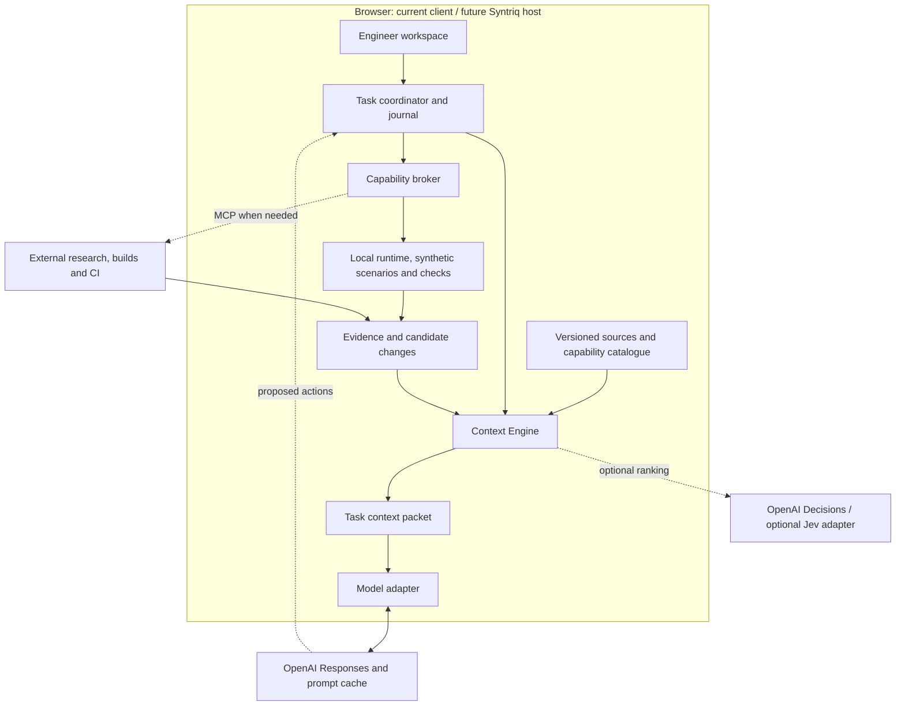

# Browser-first AI context and agent architecture

**Status:** Research and architecture proposal, 2026-10-13. No context engine, Jev integration, vector index or additional agent framework is implemented by this document. Inspected repository baseline: `b1cdb58040924424f51f4b0e5d8a60d8fe518542`.

This extends the [engineering workbench architecture](engineering-workbench-architecture.md). [Delivered client scope](client-runtime-status.md) remains the implementation record. Syntriq stays a separate product and future host; the current client is the proving environment.

**Provider decision:** OpenAI is the primary API target. The [OpenAI integration architecture](openai-integration-architecture.md) supersedes the provider-selection examples below and specifies the browser tool loop, relay, continuation and cache contracts. Evaluate OpenAI Decisions first for optional narrow judgments; Jev remains a comparison behind the same adapter.

## 1. Decision

Add a small **Context Engine** to the generic engineering kit. It gives any plugged-in model a versioned view of what exists, what is supported, what the task requires and what has actually been verified. It is a browser module with existing storage APIs, not a new database engine or an autonomous backend.

Start with a component catalogue, exact and lexical search, explicit dependency traversal and source reads. Add local embeddings when measured retrieval misses justify them. Use document trees for long specifications, summaries for navigation, and OpenAI prompt caching for repeated model input. OpenAI Decisions is the first optional narrow-decision experiment; Jev is an alternative to compare if needed. The main reasoning model proposes changes; deterministic tools and independent tests establish whether they work.

The browser owns the task, source selection, candidate overlay and evidence. AI providers receive bounded context and return proposals. Replacing a model must not lose the task or change the platform's acceptance criteria.

## 2. Why a model cannot just know the platform

A model connection does not load our repository. MCP discovery does not automatically supply the relevant resources or decide which implementation is current. A long conversation also mixes old plans, failed attempts and superseded facts.

Every run therefore needs five explicit answers:

| Question | Authoritative input | Precision gained |
|---|---|---|
| What already exists? | Package/module catalogue, API and handler contracts, source locations and examples | Reuse existing components and edit the correct source |
| What works here? | Runtime capability manifest plus provider availability | Avoid confusing declared semantics with executable browser support |
| Which version am I changing? | Baseline revision, candidate digest and current workspace revision | Prevent changes or test claims based on stale state |
| What must be true? | Independent requirements, acceptance cases and domain invariants | Avoid measuring correctness only against the model's own implementation |
| What happened in this task? | Structured journal, decisions, failed attempts and evidence references | Resume without replaying an entire chat or repeating a known failure |

For example, the current `model/client-capabilities.json` lists `submitCorrection` and named rule checks. It explicitly excludes full SHACL, OWL reasoning, temporal writes and production authorization. Those exclusions belong in the task's mandatory context when relevant. A semantic definition in the ontology is not evidence that the browser can execute it.

## 3. Placement



These are logical modules. We can implement them in the current repository without deploying a service for every box. The application runtime remains independent of the engineering kit and cloud models.

| Layer | Location and responsibility | Initial implementation |
|---|---|---|
| Source and capability inventory | Browser reads a versioned bundle produced from repository sources | JSON manifest and source references; no model call |
| Search and dependency index | Browser worker, with immutable index assets where useful | Exact IDs, symbols, lexical search, module tree and explicit graph edges |
| Context assembly | Browser | Scope filters, source freshness, mandatory constraints, budgets, provenance and gaps |
| Task coordination and memory | Browser | Existing XState pattern, bounded steps, cancellation and IndexedDB journal |
| Optional semantic retrieval | Browser worker by default | Compatible small embedding model; retain lexical fallback |
| Narrow probabilistic decisions | Optional cloud model adapter | Evaluate OpenAI Decisions first; no dependency in the basic path |
| Reasoning and generation | Selected cloud model | Planning, explanations and candidate edits using the supplied evidence |
| Runtime and scenario checks | Browser for supported operations | Existing registered checks, fixed-point services and seeded synthetic scenarios |
| Full semantic build and release checks | Existing external providers/CI | Python/reference or browser-automation work that is not implemented in-page |

There is a practical boundary to “only cloud model calls.” Browser authentication and CORS must be supported by the chosen endpoint. A provider requiring a privileged API key needs an existing authenticated connector or a small inference relay. Do not bundle that key into the client. Full Python builds, external research and independent CI remain explicit exceptions from the existing workbench plan. This does not require a general application backend.

## 4. How the AI discovers existing components

### Build a catalogue from actual sources

Extend the package build with a separate engineering context bundle. A production application bundle need not ship its entire source tree. The workbench can load a curated source bundle or fetch authorized source blobs on demand.

Each catalogue entry should contain:

- Stable component or semantic ID, kind, purpose and source-of-truth path.
- Input/output contracts, handler bindings and supported runtime/provider versions.
- Dependencies, consumers and links to applicable requirements and tests.
- A small usage example, implementation status and known unsupported features.
- Source content hash and the revision that supplied it.

Derive available edges from imports, profiles, rule registrations, generators and workflow bindings. Explicitly maintain requirement/test links that cannot be inferred. Mark guessed relationships as suggestions until verified. The ontology supplies domain relations; it is not automatically a complete software dependency graph.

A catalogue entry claiming a component exists must resolve to a source or installed provider contract. A roadmap entry is tagged `planned`. Absence from a partial index means `unknown`, not `absent`; search coverage must be visible before the agent proposes a duplicate component.

### Retrieve progressively

1. Pin the application pack, source snapshot, candidate overlay and task scope.
2. Load a compact core: goal, architecture boundaries, relevant capability exclusions and entry-point catalogue.
3. Search exact identifiers and lexical terms; preserve semantic IRIs and punctuation in code symbols.
4. Expand to dependencies, callers, requirements, generator ownership and tests. Bound traversal depth and report truncation.
5. If terminology differs or the first pass has gaps, use semantic search; merge and deduplicate candidates rather than replacing exact matches.
6. Use a document tree for long prose when headings and sections provide a better route. Read original leaf passages before relying on a summary.
7. Assemble the packet, show missing evidence, and allow the agent to request additional scoped reads.

This combines a small initial context with just-in-time inspection, consistent with the approach described in Anthropic's context-engineering guidance [R1]. The ordering above is our recommendation for this repository, not a published universal optimum.

### Offer a small context API

Proposed internal operations are `context.catalog`, `context.search`, `context.read`, `context.related`, `context.assemble` and `context.explain`. These are contract proposals, not installed tools. They use the same local capability broker as the workbench; a later MCP adapter can expose an appropriate subset.

The model sees a compact capability menu, then receives only the tool schemas needed for the current phase. A provider may advertise more capabilities than the task is allowed to invoke. The broker enforces that distinction independently of the prompt.

## 5. What the different research approaches contribute

The sources were reviewed on 2026-10-13. Several influential papers are from 2023–2025; current product documentation should not make those methods appear newly invented in 2026. No external benchmark establishes the best configuration for our application.

| Approach | What the research or product does | Recommendation for this platform |
|---|---|---|
| Hybrid/contextual retrieval | Combines lexical and semantic retrieval; contextual retrieval adds document context to indexed passages [R2] | Begin with exact/lexical search. Include deterministic metadata such as module, heading and symbol. Evaluate embeddings and reranking after baseline misses are measured |
| PageIndex | Creates a document tree and uses model reasoning to navigate it. The reviewed local quickstart uses Python and model API calls [R3] | Useful for long specifications and imported manuals. Reuse the idea of navigable headings locally; do not assume its SDK is browser-native or “local” means no cloud inference |
| RAPTOR | Recursively embeds, clusters and summarizes text into a multilevel retrieval tree [R4] | Optional for a large prose corpus. Summaries locate evidence; they do not replace current source code or exact rule definitions |
| Microsoft GraphRAG | Extracts entities/relations from text and builds community summaries for retrieval [R5] | First traverse our explicit model, module and requirement links. Consider extracted graphs later for unstructured research; preserve confidence and source provenance of inferred edges |
| Cache-Augmented Generation (CAG) | Preloads a bounded knowledge collection into long context and reuses model computation [R6] | A useful pattern for a small stable platform primer. Keep changing source and task evidence selectively retrieved |
| RadixAttention, CacheBlend and LMCache | Reuse or manage inference KV state; CacheBlend handles non-prefix reuse with selective recomputation [R7–R9] | These belong to model serving. Use documented provider caching APIs; do not build a browser KV infrastructure for someone else's cloud model |
| Jev | Produces typed choices, scores or yes/no probabilities from supplied state [R10] | Optional semantic routing or passage ranking after local filtering; not the source store, code generator or validation authority |

There are three distinct trees here: a document tree organizes evidence, a dependency tree/graph organizes application relationships, and a radix tree organizes reusable model computation. One cannot substitute for the others.

## 6. Context packets and task memory

The Context Engine should produce a versioned structured packet before every model step. A model-specific adapter serializes it and reports usage; it does not decide what counts as authoritative.

```text
ContextPacket
  identity: task, application pack, baseline, candidate, workspace revision
  intent: goal, current phase, acceptance criteria, allowed change scope
  constraints: relevant capability limits, source ownership, granted actions
  evidence: source IDs, hashes, locators, selected excerpts, retrieval reasons
  state: pending diff, current findings, pinned seed/clock, provider availability
  memory: decisions with rationale and references, rejected attempts, open questions
  gaps: missing sources, unsupported checks, incomplete index coverage
  execution: tool contract versions, token/tool/time budgets, cancellation handle
```

Keep three memory scopes: a small project primer, the current task journal, and optional reusable lessons. A lesson records its source scope, version and evidence; it becomes a hypothesis when those dependencies change. Keep observations, user decisions and model suggestions distinguishable. Store concise rationale and results, not hidden model reasoning.

The OpenAI adapter separately retains opaque provider continuation items as required for replay. These are not readable project memory or acceptance evidence; see the [continuation contract](openai-integration-architecture.md).

Compaction preserves unresolved requirements, constraints, failed attempts and evidence pointers. It must not convert “planned” into “implemented,” or “browser checks passed” into “released.” Before resuming, resolve source references again and reconcile in-flight provider jobs.

Set budgets by the selected model's actual context limit and measured task needs. Reserve room for output and tool results. Mandatory constraints and direct evidence take priority over historical dialogue. If required evidence will not fit, split the task or fetch it over multiple steps; do not silently truncate a necessary invariant.

The UI should expose **Context inspector**: what was sent, why it was selected, source version, missing context, usage and cache hits. This makes context failures diagnosable instead of asking engineers to guess why an answer changed.

## 7. Caching without stale authority

Caching primarily saves repeated work. Fresh source selection, contracts and verification are what improve precision. A cache hit is never a correctness badge.

| Cache or memory | Where | Key and invalidation contract |
|---|---|---|
| Source and package blobs | Browser, content-addressed objects | Content hash; immutable values. The selected snapshot decides which version is current |
| Parsing, lexical index, embeddings and summaries | Browser, optionally prebuilt as assets | Source hash plus parser/chunker/index/model/prompt version. Rebuild affected summaries and ancestor nodes when leaves change |
| Retrieval results | Browser | Query, scope, source/index revision, candidate digest and permissions. Start with exact keys; re-check grants and freshness on access |
| Pure tool results | Browser | Exact inputs, implementation version, relevant source/runtime digest, workspace snapshot, seed and virtual clock. Cache only declared pure or snapshot reads |
| Task journal | Browser | Task and workspace identity; append recorded outcomes. Revalidate remembered facts before acting |
| Prompt/context cache | Cloud provider | Provider/model-specific cache identity and documented lifetime. Stable instructions/schema first, varying evidence and task state later where the API permits |
| KV reuse and offload | Model serving infrastructure | Model/runtime/layout compatibility; not portable memory shared freely between cloud providers |
| Semantic answer cache | Deferred | Similar wording is insufficient to reuse a code patch, approval, validation result or write operation |

Provider APIs differ. Google's current documentation distinguishes implicit caching from explicit cache objects and notes different support across its API surfaces [R12]. The model adapter must discover/configure the supported mechanism and record actual cached-token usage; never depend on a guaranteed hit. Cached context still has to obey the model's context limits and current task scope. A cache miss or expiry falls back to a normal request.

Use one knowledge revision for the selected source map and index definitions, a candidate digest for the overlay, and workspace revisions for changing application state. They are different identities. A documentation-only edit should refresh relevant retrieval without pretending that unrelated runtime execution changed. Test evidence continues to name the actual runtime/candidate inputs it verified.

A tariff rule edit invalidates its derived rule summary, affected retrieval results and relevant scenario evidence. An unchanged source blob can still reuse its parse or embedding. A permission change invalidates access regardless of content hashes. Never serve one workspace's private cached result to another scope, and never replay a cached mutation as a new command.

## 8. Jev's precise role

This remains a research comparison. OpenAI Decisions is the preferred first experiment for the equivalent optional role, as specified in the [OpenAI integration plan](openai-integration-architecture.md).

Assuming “Jev” means TypeSafe's Jev: it evaluates supplied state using typed question primitives. Choice and Score return distributions and a derived confidence value; Noul returns a yes/no probability [R10, R11]. It still needs our Context Engine to supply the right evidence.

Potential experiments:

- Select a task category or relevant capability from a locally filtered, allowed set.
- Rerank ambiguous research passages after exact/lexical retrieval.
- Classify a failure explanation as a likely modelling, implementation, fixture or provider issue.

Each decision includes an `insufficient-evidence`/`none-of-these` outcome where appropriate. The coordinator can gather more evidence, use the reasoning model or present ambiguity. Routine identifier lookup and dependency traversal stay deterministic. Independent questions can be batched, but each must contain the evidence it needs.

The reported confidence summarizes its output distribution; `0.9` must not be presented as a measured 90% correctness guarantee on our tasks. Calibrate thresholds on held-out application cases and include option-order changes. A well-typed answer can still be wrong.

TypeSafe's published `jev-1.13` limitations, reviewed there on 2026-10-02, include numerical/date reasoning, irrelevant context, option order and adversarial input [R13]. Therefore billing arithmetic, revision checks, permission checks, invariant evaluation and final release decisions remain deterministic. Jev may suggest a failure category; it cannot declare a failed test passed.

The reviewed JavaScript quickstart targets Node.js 20+ with an API key [R14]. Browser CORS, safe public-client authentication and local weights were not established by that documentation review. Treat Jev as an optional cloud adapter through a suitable connection, not as an assumed in-browser model. Its latency and quality for our tasks remain unmeasured.

## 9. Agent operation and feedback

Use one coordinator and explicit phases: understand, inspect, plan, modify, validate and review. These can be roles of the same model rather than six independent agents. Start with one writer to the candidate overlay. Read-only parallel research can be added when tasks are independent and the benefit is measured.

Each phase receives a scoped packet and returns typed artefacts: source references, findings, proposed change set, test requests or review findings. Shared evidence IDs connect phases; copying whole conversations does not.

Before applying a proposed edit, the broker checks the expected revision, source ownership, schema and task grant. After applying it, the coordinator recompiles supported outputs, updates indexes and invalidates affected evidence. The verifier runs independent acceptance cases and suitable synthetic scenarios. A reviewer can identify further gaps, but another model's agreement is not proof of correctness.

Bound retries, tool calls, model tokens and elapsed time. Stop for missing capabilities, repeated identical failures or exhausted budgets. Record the cause so the engineer can resume from a stable point. A closed browser cannot continue a local autonomous loop; durable external jobs require provider support and reconciliation.

External documents, tool descriptions and source comments remain evidence, not permission to change the task's instructions. Workers move trusted computation off the UI thread; they do not safely contain arbitrary generated code with access to the same origin. Keep the isolation and provider boundaries defined by the parent workbench architecture.

### Example: extending late-evidence correction

An engineer asks for an additional correction approval condition. The catalogue locates the current task profile, `submitCorrection`, correction workflow, rule registrations, associated requirements and tests. Retrieval follows those links, then supplies source passages and the explicit browser support limits.

The agent proposes a source change against the pinned candidate. A seeded scenario exercises valid evidence, mismatched evidence, duplicates and stale revisions. The resulting assertions and traces become evidence for the next model step. Required full-semantic checks remain pending until the reference provider runs. Changing the condition invalidates the affected verification records immediately.

If the requirement needs an unimplemented evaluator, the system reports a capability gap. It must not assume that adding a rule name makes an executable rule exist.

## 10. Browser implementation and persistence

Use IndexedDB for the catalogue, index metadata, task journal and evidence references. Use OPFS only if large immutable source/index files justify it. Cache Storage is suitable for versioned HTTP assets and model downloads. These existing browser facilities have different purposes; none requires us to invent a database engine [R15].

Keep rebuildable indexes separate from unsaved user changes. Handle quota failures, expose storage usage, request persistence where appropriate and provide task export/import. Browser storage is not cross-device synchronization or a substitute for committed source. The journal should be useful even with embeddings unavailable.

Transformers.js supports browser inference via ONNX Runtime with WASM and optional WebGPU [R16]. This makes local embeddings a plausible extension. Evaluate model download size, memory, cold start and worker responsiveness on supported devices. Do not require a local generative LLM for the first implementation. Small corpora can use a simple in-memory vector scan; add an established index library only when measurements show a need.

At larger scale, load module-level indexes lazily, update changed blobs, cap worker memory and retain exact-search fallback. Optional remote retrieval can serve very large corpora through the same contract later, with explicit data scope. It is not an initial dependency.

## 11. Delivery order and measurable gates

These additions refine the workbench's E1–E6 sequence; they do not replace the remaining generic runtime work.

| Increment | Relationship | Acceptance gate |
|---|---|---|
| C1: Inventory and evidence identity | E1 and E2 | Generated catalogue resolves to real sources; planned/implemented/unsupported states are distinct; run evidence has replay inputs |
| C2: Context Engine and inspector | E3, prerequisite for live E4 | Exact/lexical/dependency retrieval, scoped source reads, candidate invalidation and inspectable packets work without an LLM |
| C3: Resumable assisted loop | E4 | Scripted then cloud adapter uses the same contracts; switching model preserves task/evidence; stale edits and unsupported tool calls fail closed |
| C4: Measured retrieval upgrades | After baseline evaluation | Local embeddings, document trees or Jev improve held-out outcomes enough to justify their resource/latency cost |
| C5: Provider-specific efficiency | E4/E5 when supported | Prompt caching reports actual hits; expiry, model change and provider failure preserve correctness |
| C6: Host/application portability | E6 | A neutral application and minimal host fixture use the same context contracts without ChargeWeave names in the core |

Use representative engineering tasks and independent expected outcomes: find an existing capability; modify a source behind a generated artifact; reject an unsupported rule; detect stale revisions; preserve rounding boundaries; handle missing research; resume after compaction; resist instructions embedded in retrieved content; operate after cache eviction; and switch model mid-task.

Measure required-source recall within the token budget, unsupported claims, stale-evidence use, task success under independent tests, repeated failures, tokens, cloud requests, cold/warm latency and browser memory. For Jev, add decision accuracy, abstention coverage and calibration on held-out cases. Keep task variants separated between tuning and evaluation.

Compare baseline exact/lexical retrieval against dependency expansion, hybrid search, document trees and optional reranking. Toggle caching separately so reduced cost is not confused with increased quality. Required constraints must not be dropped to improve token counts. Unknown capabilities must never receive a passing badge. Published vendor benchmark percentages are not our acceptance results.

**Next implementation:** C1 alongside E1/E2, then C2 as part of the candidate workspace. Keep Jev, vector retrieval and summary-tree generation optional until this baseline identifies a concrete failure they can fix.

## 12. Primary sources

Accessed 2026-10-13. Source descriptions establish capabilities and research methods; platform choices and sequencing above are design recommendations.

| ID | Source |
|---|---|
| R1 | [Anthropic: Effective context engineering for AI agents](https://www.anthropic.com/engineering/effective-context-engineering-for-ai-agents) |
| R2 | [Anthropic: Contextual Retrieval](https://www.anthropic.com/engineering/contextual-retrieval) |
| R3 | [PageIndex official repository and current quickstart](https://github.com/VectifyAI/PageIndex) |
| R4 | [RAPTOR paper, 2024](https://arxiv.org/abs/2401.18059) |
| R5 | [Microsoft GraphRAG documentation](https://microsoft.github.io/graphrag/) |
| R6 | [Cache-Augmented Generation paper, revised 2025](https://arxiv.org/abs/2412.15605) |
| R7 | [SGLang / RadixAttention paper, revised 2024](https://arxiv.org/abs/2312.07104) |
| R8 | [CacheBlend paper, revised 2025](https://arxiv.org/abs/2405.16444) |
| R9 | [LMCache documentation](https://docs.lmcache.ai/) |
| R10 | [TypeSafe Jev introduction](https://docs.typesafe.ai/introduction) and [state contract](https://docs.typesafe.ai/concepts/state) |
| R11 | [TypeSafe confidence semantics](https://docs.typesafe.ai/confidence) |
| R12 | [Google Gemini context caching documentation](https://ai.google.dev/gemini-api/docs/caching) |
| R13 | [TypeSafe: Jev 1.13 limitations](https://docs.typesafe.ai/model-jaggedness/jev-1.13) |
| R14 | [TypeSafe JavaScript SDK quickstart](https://docs.typesafe.ai/sdk/javascript) |
| R15 | [MDN browser storage, quotas and eviction](https://developer.mozilla.org/en-US/docs/Web/API/Storage_API/Storage_quotas_and_eviction_criteria) |
| R16 | [Hugging Face Transformers.js](https://huggingface.co/docs/transformers.js/index) |
