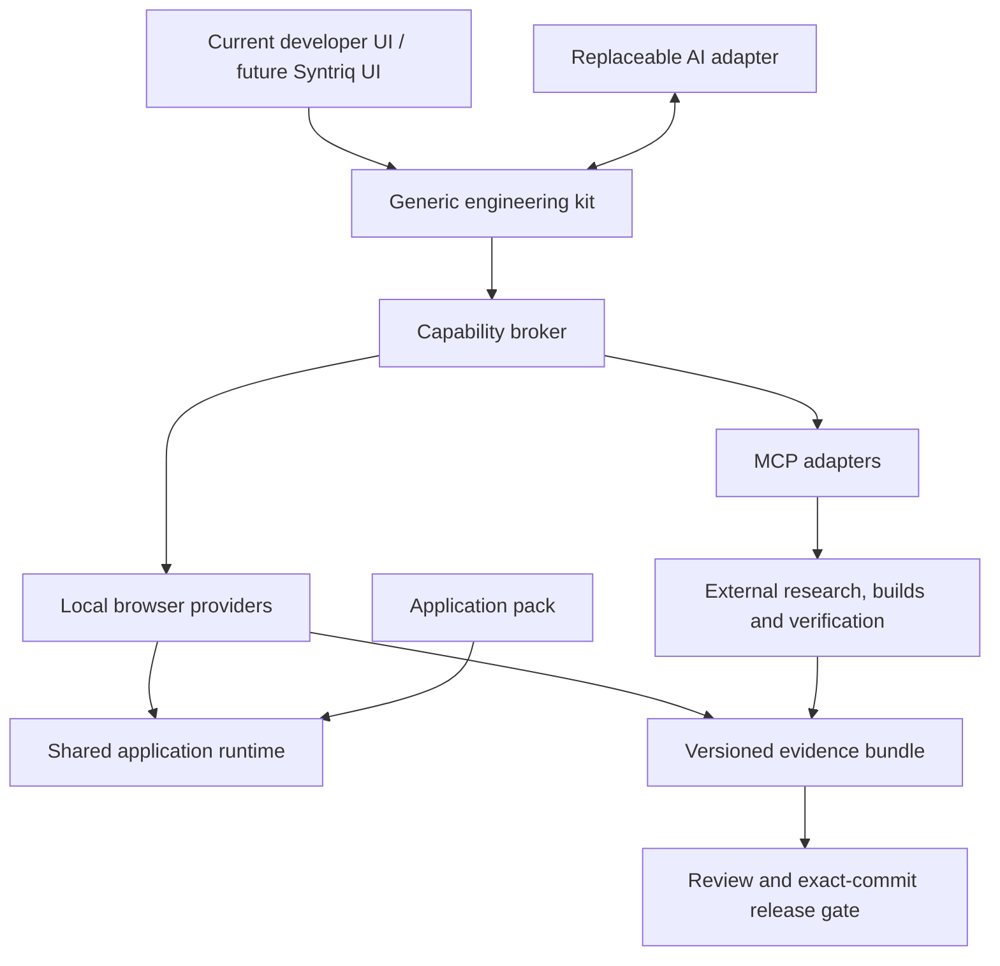
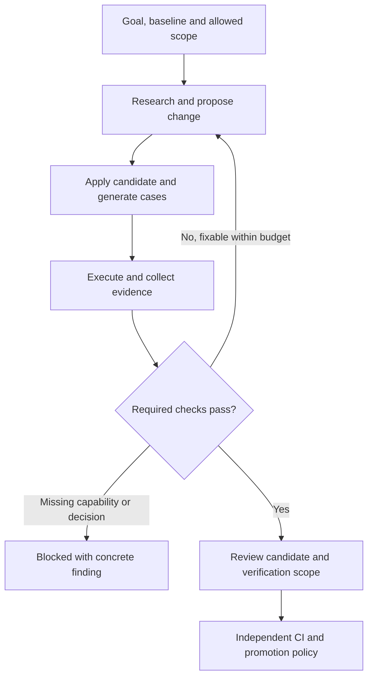

# Browser-first engineering workbench

**Status:** Architecture proposal, 2026-10-13. This document adds a design and delivery sequence; it does not claim the workbench, MCP integrations or Syntriq integration are implemented.

**Inspected source:** [`0736fcb3261288e1da212bd32a1b911b3aee3761`](https://github.com/pli-poc/charge-weave/tree/0736fcb3261288e1da212bd32a1b911b3aee3761). [Current delivered client scope](client-runtime-status.md) remains authoritative for what works today.

## 1. Decision

Make the engineering process a reusable client capability. An engineer should be able to describe an application or change, invoke AI, inspect research and model changes, generate synthetic cases, run the application, investigate failures and repeat from one workbench.

**Syntriq is the intended host UI for that workbench. ChargeWeave is its first application pack and current proving client.** The engineering kit and application runtime must be independent of either product's shell. Astra or another AI can assist through a replaceable model adapter; a particular assistant or chat session must not own the workflow, tools, memory or acceptance criteria.

Use a small capability broker with in-process browser providers first. Add MCP adapters for external tools where they are useful. Keep GitHub Actions as the independent, commit-bound release gate. Engineers should not have to commit every experiment to get feedback.

The immediate implementation boundary remains the existing browser client. This design does not bring Syntriq's backend into ChargeWeave, create a database engine, deploy an agent service, or require live business integrations. Syntriq product internals were not inspected for this design; its host integration is a proposed contract, not a statement about an existing Syntriq implementation.

## 2. Product and ownership boundaries

| Part | Owns | Must remain independent of |
|---|---|---|
| Host shell | Navigation, editor panels, user interaction and connection setup; initially the current developer client, later Syntriq | Domain calculations and the validation oracle |
| Generic engineering kit | Change workspace, capability broker, task coordinator, scenario runner, evidence and comparison contracts | ChargeWeave names, a particular LLM, GitHub-specific UI and Syntriq business services |
| Generic application runtime | Package loading, local GraphQL, application-service ports, registered rules, XFlow/XState execution, temporal/analytical interfaces and checkpoint coordination | Engineering chat, MCP transport and source-control credentials |
| Application pack | Domain semantics, requirements, rules, workflows, tasks, views, handlers, scenarios and adapters | Host navigation and provider transport |
| External capability providers | Research, AI inference, complete semantic validation, isolated builds, repository operations or remote browser testing | Ownership of the workbench's acceptance decision |
| Verification authority | Independently checks the exact candidate and records release evidence | The AI's claim that its own change is correct |

These are logical modules, not a request for six repositories or microservices. Start as a modular client in the existing repository. Extract distributable packages only when a second consumer exercises the boundary. Keep the existing `client-runtime` package name during this work; namespace migration is a separate decision.



The GraphQL API serves the modelled application. MCP exposes engineering capabilities to the workbench/AI. Neither replaces the other. Business workflow services continue to call injected services directly; they do not start assembling MCP calls or depend on an AI to make a deterministic business decision.

## 3. What we can reuse, and what is genuinely missing

| Existing source | Reuse | Remaining work |
|---|---|---|
| `client-runtime/src/graphql/client.js`, `src/flow/`, `src/services/` | Local typed execution, allowlisted flow compiler, validation and exact decimal utilities | Present reusable operations through capability adapters; add multi-task/application coverage incrementally |
| `client-runtime/scripts/build-package.mjs` | Contract checks, generated SDL/descriptors and input/artifact hashes | Separate pure compilation from Node filesystem/hash wrappers; replace fixed namespace, single `task`, built-in query roots and mandatory profiles with explicit module inputs |
| `model/client-*-profile.json`, `client-capabilities.json` | Source ownership and explicit supported subset | General application manifest, requirements inventory, module dependencies and version compatibility |
| `src/profiles/chargeweave/` | Working correction service, handler bindings and rating behavior | Keep these domain-specific; register them as the first application adapter |
| `src/adapters/browser/checkpoints.js` | Atomic IndexedDB checkpoint, conflict detection, import/export and integrity checks | Separate engineering-workspace journal and candidate namespace; no automatic reinterpretation of old instances |
| `website/src/simulation/core.js`, `runtime.js`, `stores.js` | Versioned seeded PRNG, virtual clock, five fault/journey scenarios and replaceable simulation adapters | Extract reusable seed/clock/runner ports; keep OCPP/OCPI and simulated stores in the ChargeWeave adapter |
| `console-app/src/analytics/fixture.js` | Repeatable synthetic year, late corrections and declared population/time semantics | Versioned generator adapter; it is currently formula-based, not a configurable seeded universal generator |
| `tools/build_journey_snapshots.py`, `tests/journey-snapshots.json` | Full-graph synthetic journeys and semantic evidence | Expose manifest/results through the same scenario/evidence vocabulary; execution remains Python initially |
| `tests/negative-cases.json`, `adversarial-cases.json`, acceptance/lifecycle tests | Independent expected failures and business acceptance cases | Map cases to requirements and impacted features in the workbench |
| `model/temporal-example.json` and temporal parity tests | 63 committed reference selections and provenance | Reusable conformance-suite adapter; retain the independent Python/SPARQL reference |
| `requirements/`, business audit and research sources | Independent actors, responsibilities, requirements and evidence | A coverage panel connecting requirements to executable cases; model conformance alone is insufficient |
| Existing Node tests, Playwright checks and GitHub workflows | Compiler/runtime regression, assembled-app browser checks and semantic release gates | Shared scenario definitions and evidence adapters; an in-page runner does not itself launch Playwright |
| [Semantic modeler roadmap](semantic-modeler-roadmap.md) | Planned model projections and distinction between layout edits and semantic edits | Optional editor in the workbench; it is still planned and is not required for a first test studio |

The neutral document-review test is a useful portability probe. It is not yet a complete second application with multiple tasks, generic handler discovery, browser authoring and its own independent namespace. Those become explicit acceptance gates below.

## 4. Engineer experience

The workbench should expose six coordinated views, all following the same selected candidate and run:

| View | Engineer sees and does |
|---|---|
| Intent and plan | Goal, scope, source revision, open assumptions, affected requirements, proposed steps and execution budget; invoke or stop AI |
| Model and changes | Semantic/profile changes, generated API diff, capability gaps, source citations and affected journeys; accept or undo a candidate locally |
| Synthetic data and scenarios | Select generator/seed, population, virtual time, valid/invalid cases, faults and expected outcomes |
| Live preview | Run the candidate application, inspect forms and tasks, advance simulated events/time and compare behavior with the baseline |
| Evidence | Violations, traces, failed assertions, requirement coverage, unsupported checks, replay handles and baseline/candidate comparison |
| Providers and release | Provider availability/versions/scopes, external work progress, code diff, CI status and promotion readiness |

The main action is **Run checks**; an engineer can also ask AI to **Investigate failure** or **Implement the next bounded change**. A report explains whether the failure belongs to a model contract, application behavior, fixture expectation, unsupported runtime capability or provider outage.

Use explicit states: `draft`, `checking`, `failed`, `blocked`, `browser-verified`, `reference-verified`, `ci-verified`, `ready-for-review`, `released`. Each verification badge includes the candidate digest, scope and evidence link. There is no single green indicator that hides unrun checks. A later edit invalidates the affected verification badges immediately.

Engineers can work manually through every step. AI augments the same commands and evidence; it is not a second privileged route around them.

## 5. The engineering kit

### 5.1 Source workspace and candidate builder

Keep four things separate: pinned baseline sources, a reversible candidate overlay, generated immutable application artifacts, and runtime workspace state. Never edit the executing released package in place.

A change operation carries a base revision and expected file/artifact hashes. Apply a validated change set atomically to the overlay; conflicting edits require a new comparison. Track add/change/delete operations explicitly, source ownership, and which generated artifacts need rebuilding. Edits to generated-only SDL, shapes or catalogues are rejected as source changes.

The browser can immediately run prebuilt packages. To preview edits locally, first extract the pure subset of the existing compiler into a browser-compatible module, with filesystem access and SHA-256 supplied by environment adapters. The current module imports `node:fs` and `node:crypto` and is not browser-ready merely because it exports `compileApplication()`.

Initially allow profile edits whose inputs are fully available and supported locally. An ontology source edit requiring the Python generator creates a draft and invalidates derived artifacts; it cannot receive a fresh package label until a compatible build provider or CI regenerates them. Porting Python, OWL reasoning or every SHACL feature to WebAssembly is not a prerequisite.

### 5.2 Capability broker

Use one typed `invoke` contract with versioned input/output schemas and an implementation registry. Providers advertise capabilities; the host grants a narrower, task-specific subset. The broker chooses a compatible provider, checks inputs and scopes, enforces limits, records provenance and validates the result.

Local adapters call pure functions or workers. MCP adapters translate the same internal operation into an external tool call. Keep the internal contract transport-neutral: a local function is not advertised as a functioning MCP server.

Do not automatically trust a tool's name, annotations or discovery description as proof of permission or correctness. Pin provider identity, implementation/version, schemas and granted scope for each run. Refresh discovery when needed, but stop for compatibility review if a pinned contract changes during execution.

### 5.3 Task coordinator and AI adapter

Use a small explicit state machine, reusing the installed XState library. Keep engineering execution state separate from business XFlow actor state. Avoid building another general workflow engine or recursive multi-agent framework.

The coordinator owns the plan, candidate, tool budget, cancellation and run journal. The model adapter takes a bounded context and returns proposed steps or tool requests. It does not receive unrestricted source-control, network or shell authority. AI provider selection can change without changing the plan/evidence formats.

The [context architecture](ai-context-architecture.md) defines how that bounded context is assembled: a versioned component/capability catalogue, exact and lexical search, explicit dependency traversal, scoped source reads and a structured task journal. It separates browser data caches from cloud prompt/KV caching and places optional semantic retrieval, document trees and Jev behind measured upgrade gates. This is a proposed engineering-kit capability, not an implemented memory service.

Persist stable step boundaries locally. On reload, reconcile any external task handle before retrying. A browser that is closed is not a background worker. A remote job may continue only if its provider explicitly supports durable task handles; otherwise mark the step interrupted and resume deliberately.

### 5.4 Scenario runner and evidence recorder

Run a declarative scenario against an immutable candidate and fresh synthetic workspace. Inject clock, ID source, seed, adapters and a bounded command/event schedule. Assert business outcomes, rejected operations, trace properties and saved-state behavior. Keep failures and unsupported requirements visible even when other checks pass.

Use Web Workers for trusted computation that would block the UI. Terminate overdue jobs, bound inputs/output sizes and use progress/cancellation messages. Worker isolation is a responsiveness boundary, not permission isolation for arbitrary generated JavaScript.

Reuse scenario definitions across the in-page runner, Node contract runner and browser automation adapter. Do not copy all Playwright tests into a new browser test language. Page navigation, accessibility, real browser behavior and protected-build checks continue in their appropriate harness.

## 6. Provider catalogue and MCP boundary

Start with logical providers, not a new server for each feature. A later generic-platform MCP server may expose several capability groups; independently privileged research/repository/build systems can remain separate providers.

| Capability group | Proposed operations | First execution location | Current underlying assets |
|---|---|---|---|
| Model and contract | `model.inspect`, `model.diff`, `model.checkCapabilities`, `package.compilePreview` | Browser for loaded contracts/supported compiler subset; Node/Python for full build | Generated catalogues, package compiler, profile checks |
| Synthetic data | `fixture.list`, `fixture.generate`, `scenario.expand`, `fixture.validate` | Browser for small JS fixtures; optional worker/provider for full graphs/large populations | PRNG, virtual clock, simulation/year generators, Python journey builder |
| Runtime and simulation | `runtime.start`, `runtime.command`, `runtime.advanceClock`, `runtime.snapshot`, `scenario.run` | Browser with explicit workspace handles | Shared runtime and simulator adapters |
| Validation and tests | `validation.run`, `tests.run`, `tests.compare`, `coverage.inspect` | Browser subset; reference provider/CI for full semantics and browser automation | Named evaluators, Node/Python tests, Playwright |
| Evidence and replay | `evidence.inspect`, `run.replay`, `bundle.export` | Browser first | Existing traces, receipts, package hashes and checkpoints; common envelope is new |
| Research | `research.search`, `research.read`, `research.capture` | Approved external provider, invoked from the UI | Existing source registry supplies initial context; no live research connector is assumed |
| Source/build | `workspace.diff`, `workspace.applyPatch`, `build.candidate` | Restricted local overlay; isolated external build for arbitrary code | Repository generators and lockfiles |
| Repository/verification | `repository.propose`, `verification.start`, `verification.inspect` | Existing repository/CI provider | GitHub Actions and existing publication boundary |

These names describe the proposed internal API; they are not claims about installed MCP tools. An MCP adapter can map them to valid, provider-specific tool names and must expose structured outputs. Model packages, schemas, scenarios and evidence are suitable read resources; reusable research/review instructions can be prompts. Neither resources nor prompts grant execution authority. MCP defines host/client/server interaction and capability exchange; our coordinator owns the engineering process. [S1, S4]

### Browser connection rules

- Use a compatible MCP HTTP transport for remote connections. Browser access also requires an endpoint whose authentication and CORS behavior supports the selected host origin. Use provider-supported public-client authorization where available; keep privileged provider secrets out of application bundles and persisted run records. [S2, S3, S7]
- A normal browser tab cannot launch a stdio server or execute a shell. A stdio-only provider requires a separately installed companion or external runner; that is a later integration and not a browser-only capability. [S2]
- A model adapter may use a browser-safe inference endpoint or an existing authorized gateway. Do not require building a proprietary AI backend just to test the client. With no connection, manual mode and a deterministic scripted adapter must remain useful.
- Pin and test a protocol/SDK version matrix when implementing the connector. The sources reviewed for this design include MCP revision `2026-07-28`; do not mix its wire behavior with older `2025-11-25` examples. Core contracts below intentionally avoid protocol-version-specific wire envelopes.
- Add connection diagnostics for unavailable endpoint, unsupported version, authorization expiry, CORS restriction and missing capability. External failure becomes `blocked` or `error`; it never becomes a passing test or a silent fallback to weaker validation.

The future **generic platform MCP provider** should expose model inspection, scenario generation, declared runtime execution and structured validation/evidence. Domain packs add registered capabilities and resources. It should not expose arbitrary GraphQL mutation strings, unbounded SPARQL, shell access or every internal method as default tools.

## 7. Minimal contracts to implement

All types here are design sketches, not deployed schemas. Version and validate the eventual JSON schemas before exposing tools. Use decimal strings for exact decimal values; use explicit UTC instants and simulated-time metadata.

```ts
type ArtifactRef = {
  uri: string;
  sha256: string;
  mediaType: string;
};

type CapabilityDescriptor = {
  id: string;
  contractVersion: string;
  implementation: { id: string; version: string; digest?: string };
  execution: "browser" | "worker" | "external";
  inputSchema: ArtifactRef;
  outputSchema: ArtifactRef;
  effects: ("read" | "candidate-write" | "external-write")[];
  requiredScopes: string[];
  limits: { maxInputBytes: number; maxOutputBytes: number; timeoutMs: number };
  supports: { cancel: boolean; durableHandle: boolean; deterministic: boolean };
};

type Invocation = {
  runId: string;
  stepId: string;
  workspaceId: string;
  candidateDigest: string;
  capabilityId: string;
  contractVersion: string;
  expectedRevision?: number;
  idempotencyKey?: string;
  input: unknown;
};

type CapabilityResult = {
  status: "passed" | "failed" | "blocked" | "error" | "cancelled";
  candidateDigest: string;
  provider: { id: string; version: string; implementationDigest?: string };
  inputDigest: string;
  output?: unknown;
  findings: { code: string; requirementId?: string; ruleId?: string;
    sourcePath?: string; message: string; evidence?: ArtifactRef }[];
  artifacts: ArtifactRef[];
  checked: string[];
  unsupported: string[];
  execution: { environment: string; durationMs: number; replayable: boolean };
};
```

Schemas are validated both before dispatch and after results arrive. Use explicit handles for remote workspaces/jobs, scoped to the candidate and provider, with expiry and cleanup behavior. Hashes detect changed bytes; they do not authenticate a malicious provider. Trusted CI attestations and independently verifiable provenance provide a different assurance level from locally generated reports.

The **application manifest** must pin application ID/namespace, semantic/profile artifacts, requirements, enabled runtime modules, handlers/evaluators, required capabilities, scenarios, fixture generators, view/task definitions and compiler/runtime compatibility. Unsupported modules block loading affected functionality. A registry of trusted, prebundled implementation modules resolves handler IDs; model data must not contain executable code or arbitrary import URLs.

The **change set** must record base source revision, baseline/candidate digests, expected file hashes, source edits, generated diffs, impacted requirements/capabilities, rationale/source references, test changes and migration implications. A test-baseline change appears prominently alongside the implementation change.

The **evidence bundle** must record exact source/candidate/package digests, provider and harness versions, dependency lock identity, scenario/fixture/seed/clock inputs, expected and observed outputs, supported/unrun checks, event trace, relevant logs/screenshots, changed assertions, and the final scope-specific verdict. Large immutable artifacts are references, not repeated in every message. Export retains the manifest and referenced bytes needed for local replay, excluding credentials.

## 8. Synthetic data is a first-class subsystem

Synthetic testing consists of more than random rows. Use five composable parts:

| Part | Responsibility |
|---|---|
| Generator primitives | Stable IDs, seeded streams, exact scalars, enumerations, bounded cardinalities and configurable time; generic and deterministic |
| Domain recipes | Referenced entities, state lifecycles, correlations and realistic business distributions; supplied by each application pack |
| Scenario scheduler | Commands, events, human decisions, delays and virtual deadlines against the actual application service/flow |
| Fault catalogue | Duplicates, stale revisions, missing evidence, boundary decimals, denied roles, late/out-of-order data, provider failures and incompatible restores |
| Independent assertions | Required results and prohibited effects, linked to business requirements; not inferred solely from whatever the generator produced |

Each recipe declares generator/version, seed algorithm/version, package digest, population/window, virtual clock, distribution parameters, intended invariant violations and source assumptions. Use named random streams so adding one unrelated field need not shift every fixture. Distinguish observed time, received time, valid time and knowledge time where the domain requires them.

Generate valid datasets first with referential integrity, then apply named mutations to create deliberate invalid cases. Run an independent validator on intended-valid fixtures and assert the expected rejection for negative fixtures. An impossible constraint combination produces a diagnostic, never a quietly incomplete dataset or infinite retry loop. Cap generation attempts, rows and elapsed time.

AI may propose a recipe or an edge case. Deterministic code generates the data and records exact inputs. AI-authored examples alone cannot establish coverage, realism or business correctness. Preserve independently curated reference cases, requirement denominators and domain assumptions.

Reuse the existing five browser scenarios: successful charge, authorization denied, duplicate event, late meter and CDR correction. Preserve their protocol-fixture-subset labels. Wrap the synthetic analytics year and Python full-graph journey builder as different generators. Do not imply the operational correction updates the separate yearly analytics population without a declared projection mapping.

The existing simulator uses `fixture-fnv1a32` as an explicitly non-cryptographic fixture fingerprint. Keep its meaning; use SHA-256 for the new artifact/evidence identities instead of relabelling that fingerprint as a security hash. Likewise, preserve the distinction between exact correction arithmetic and existing Number-based illustrative simulation/analytics calculations.

Initially run small, representative populations in the browser. A later worker/provider can generate larger cases with the same recipe contract. Record size/latency measurements before setting scale claims. A billion generated rows is not the next milestone.

## 9. Testing that scales to another application

The reusable unit is a **versioned conformance suite plus an application scenario pack**. A new application provides its manifest, requirements and scenarios; the common harness runs the same runtime, persistence and API invariants. CI remains the execution and release authority, not the source of application-specific meaning.

| Verification level | Runs where | Proves | Does not prove |
|---|---|---|---|
| Edit feedback | Browser/UI worker | Parse/binding checks, required inputs, declared capability support and profile consistency | Full OWL/SHACL correctness or complete application behavior |
| Scenario feedback | Browser against candidate | Supported commands, flows, rule results, synthetic faults, trace assertions and checkpoint behavior | Cross-browser behavior, full semantic pipeline or production integration |
| Reference/conformance | Existing Node/Python tooling, optional provider, CI | Runtime/compiler contracts, full semantic reference checks, independent golden cases and differential results | Every real-world requirement or live protocol interoperability |
| Release verification | CI on exact source revision and assembled build | Generation consistency, required suites, browser checks and publication artifact provenance | That an untested later edit or another package is also correct |

**Keep one set of scenario and evidence contracts, with multiple execution adapters.** Share reusable assertions where meaningful, but retain independent implementations where they are the oracle, such as Python/SPARQL versus the JS tariff selector. Extract reusable test functions from Node-specific wrappers only when needed; do not move the entire existing test toolchain into the tab.

For fast iteration, build an impact graph from sources to generated artifacts, handlers/rules, requirements and scenarios. Run affected checks plus invariant smoke tests. Cache deterministic results by candidate inputs, provider/harness versions, seed/clock and suite identity. Mark cache hits and their origin. Unknown dependency impact, runtime/compiler changes, changed check definitions and release candidates trigger the complete relevant suites; an incremental green result cannot substitute for required release gates.

Use four coverage denominators: requirements, supported capabilities/rules, journey branches, and relevant fault/boundary cases. Keep `passed`, `failed`, `unsupported`, `not-run`, `not-applicable` and `waived` distinct. Waivers need an explicit rationale and reviewer; AI cannot silently remove a failing requirement from the denominator.

For a rule change, require a positive case, a deliberately failing case and relevant boundaries. Use targeted mutation checks where they resolve a real risk: removing an evaluator or weakening a constraint should cause its independent regression case to fail. Passing generated happy paths alone is not adequate evidence.

## 10. Rules and autonomy

### Do we still need a rule engine?

We need a **generic rule execution contract and registry**, building on the named evaluators already present. We do not need a new universal inference engine, proprietary rule language or database engine for this phase.

Keep structural constraints in existing sources, business invariants in canonical SHACL/domain rules, workflow decisions in registered XFlow guards, and UI presentation rules in task/view profiles. The catalogue records each rule's semantic identity, version, related requirement, evaluator capability and supported scope. Related browser checks must not claim equivalence to an entire canonical B-rule unless conformance evidence establishes it.

The command boundary evaluates required runtime checks once through application services. Full reference validation remains available through existing Python/SHACL tooling. A rule that is essential for accepting a command must have a supported evaluator before that command can run; a later green CI result does not make an unenforced client command safe to execute. Unsupported required rules produce a capability gap, not success.

A future portable expression subset is a possible extension only after real applications demonstrate repeated need. It would need explicit typing, semantics, bounded evaluation and reference parity. Do not start by designing that language.

### Bounded autonomous loop



A run grant defines allowed capabilities, writable source areas, external destinations, allowed data, iteration/time/token/cost limits, and promotion rights. Reasonable first-mode policy: freely inspect, generate synthetic data, test and change a reversible local candidate within scope; separately authorize new connections, dependency additions, trust-boundary changes and external publication according to the host's existing policy. Persist granted scope so engineers are not asked again for every harmless step.

Use explicit stopping conditions: success at the requested scope, conflicting requirements, unavailable essential capability, exhausted budget, repeated identical failure, invalid provider response, unexpected effects or user cancellation. Retrying is bounded; a changed idempotent command must use a new request identity. Non-idempotent remote operations are reconciled before retrying.

Separate proposal from acceptance. The AI may propose new tests, but pre-existing required tests, verification policy and baseline expectations cannot be weakened invisibly to make its patch pass. Changing the harness or acceptance policy is itself a visible platform change requiring independent review and full verification.

### Two kinds of extension

| Extension | Workbench behavior | Promotion condition |
|---|---|---|
| Application modelling using supported capabilities | Edit models/profiles, compose registered handlers/flows, generate fixtures and preview a fresh candidate | Required rule support, scenario/reference results, reviewed diff and exact-candidate CI |
| New platform capability or executable code | Produce a source patch and required conformance cases; use a separately isolated build/test environment, then import a rebuilt immutable candidate | Independent runtime/compiler tests, downstream pack regressions, security/compatibility review where affected and CI |

A generated script is not hot-loaded into the workbench's trusted origin. Truly autonomous implementation of new runtime code needs an isolated execution provider; until that exists, the browser can prepare and export the patch but must show execution as unavailable. That is a concrete boundary, not a reason to add a full business backend now.

## 11. Trust, storage and failure recovery

Run trusted, version-pinned packages locally. If untrusted preview code is supported later, serve it on a separate origin with a restrictive iframe sandbox and CSP, a small authenticated message bridge and no host tokens or workspace storage access. Do not combine same-origin execution with permissive sandbox flags. A Web Worker does not provide this security boundary, nor does a browser provide reliable hard memory isolation for hostile code. Use a suitable external sandbox for arbitrary code builds. [S5, S6]

External research/tool content is evidence, not authority to change instructions or tool permissions. Resolve and record sources with retrieval dates and content hashes; show contested or missing evidence as assumptions. Do not forward entire workspaces to every provider; select the minimum source/test context within the run grant.

Use IndexedDB for local engineering drafts, run journal and artifact references. Keep this store separate from application business checkpoints and UI preferences. Preserve expected revisions for multi-tab writes. Store secrets outside exported artifacts and ordinary workspace records. Local storage is resumability, not durable multi-user audit storage; quota failure/eviction must be surfaced and export must remain available.

On reload, restore stable local steps, mark running local jobs interrupted, reconcile external handles, and verify pinned versions before resuming. Package mismatch stops execution and offers export or a reviewed migration; no silent upgrade. Cancelling a run requests cancellation and records whether effects had already occurred. An interrupted write cannot simply be labelled rolled back unless the provider confirms it.

Do not claim cryptographic trust from a checksum or a locally editable run journal. CI results must be read from the trusted repository/provider and tied to the actual commit and artifact digest. Publishing uses the established source/public-build boundary; the workbench never modifies the generated public repository as its semantic source.

## 12. Delivery sequence for the current client

This is a follow-on engineering track to [P0–P8](client-runtime-build-plan.md), not a declaration that all P0–P8 work is finished. Remaining ChargeWeave journey migrations continue through the shared runtime. Only extract infrastructure required by concrete client use cases.

| Phase | Smallest useful deliverable | Acceptance gate |
|---|---|---|
| E1: Common contracts and adapter inventory | Versioned capability, invocation, scenario and evidence schemas; local broker; adapters around existing runtime/simulator; simple run journal | Existing correction and simulator execute through the broker without behavior drift; unknown required capabilities fail explicitly |
| E2: Browser test studio | Scenario selector, seed/clock controls, preview, trace/findings, replay and baseline comparison; wrappers for current synthetic generators | Replaying pinned inputs reproduces deterministic outputs; valid, negative, duplicate, late-arrival and save/restore cases are inspectable; app and engineering stores remain separate |
| E3: Candidate modelling workspace | Source overlay, structured changes/diffs, pure compiler extraction, capability report and bounded local preview compilation | Conflicts and stale derived artifacts block preview; source changes regenerate supported outputs; unsupported full-semantic builds remain visibly pending |
| E4: Model-independent assisted loop | Coordinator, budget/cancellation, model adapter interface and deterministic scripted adapter; connect an existing suitable AI endpoint when available | Same plan can be resumed and executed manually or with another adapter; invalid tool results and budget exhaustion stop cleanly; no credentials bundled |
| E5: MCP and verification adapters | Version-pinned MCP connector; external research/reference/build/repository adapters only as needed | Connection failures, expired authorization, wrong candidate evidence and retries are handled; exact candidate links to CI results; no unsupported local claim |
| E6: Second application and Syntriq seam | Neutral app with its own namespace, multiple tasks/commands, generated views, scenarios and checkpoint behavior; host adapter contract exercised by a minimal host fixture | No ChargeWeave-specific class names, fixed global task or ontology namespace in the required core path; same conformance suite and workbench operations serve both packs |

Start **E1 + E2** next. They turn today's disconnected tools into a useful browser test studio before adding AI orchestration or remote services. E3 removes the actual compiler barriers to modelling another application. E4 can begin with a scripted provider and remain useful without a live model connection. Syntriq adoption follows validation of the seam; moving these contracts into its UI must not require rewriting the generic runtime.

The [C1–C6 context increments](ai-context-architecture.md#11-delivery-order-and-measurable-gates) refine this sequence: inventory/evidence identity with E1/E2, inspectable context assembly with E3 before live E4, then measured retrieval and provider-cache upgrades. They add no requirement to deploy a vector database, Jev or an agent backend.

Full browser conformance, live services, multi-user collaboration, durable unattended agents, a server-side registry, distributed scheduling and production database integration remain separate future decisions. They do not belong in the next client milestone.

## 13. Concrete proof journeys

**ChargeWeave correction:** choose a pinned baseline and seeded correction scenario; AI or engineer proposes a rule/profile change; inspect generated API/task diff; generate valid, bad-evidence, reversed-meter, stale-revision and duplicate cases; execute actual application services and XFlow; compare exact amounts and prohibited effects; save/reload in an isolated candidate workspace; export replay evidence; submit a reviewable source change and inspect its CI results.

**New neutral application:** define a document-review application under its own namespace with submit, review and request-changes tasks. Use registered generic facilities plus an explicit application handler. Generate related documents/actors and conflicting/duplicate review events. Run the same API/revision/idempotency/flow/persistence conformance suites, app-specific requirements and browser journey. A missing runtime operation surfaces as a capability-extension request, not copied ChargeWeave code disguised by new labels.

**Platform extension:** request a previously unsupported capability. The workbench records affected consumers, contract/schema/version change, implementation patch, migration implications and independent positive/negative cases. It builds and tests in an appropriate provider, imports a new immutable candidate, runs both application packs and then links exact-commit CI. No AI self-promotion or invisible replacement of the verifier occurs.

The resulting measure of progress is concrete: an engineer can explain which requirement changed, which source owns it, which runtime capability supports it, which synthetic case proves it, which checks remain unavailable and which exact candidate is eligible for release.

## 14. Source notes

Repository claims above come from the inspected commit and linked implementation/status files. Provider APIs, workbench UX, contracts, policies and phases are proposed project design. Protocol/browser facts below were checked on 2026-10-13; implementation must pin and test compatible versions rather than follow moving documentation at build time.

| ID | Primary source | Design consequence |
|---|---|---|
| S1 | [MCP architecture overview](https://modelcontextprotocol.io/docs/2026-07-28/learn/architecture) | Distinguish host, clients, providers and the project's own coordinator |
| S2 | [MCP transport overview](https://modelcontextprotocol.io/specification/2026-07-28/basic/transports), [HTTP transport](https://modelcontextprotocol.io/specification/2026-07-28/basic/transports/streamable-http) | Separate browser HTTP connections from process-based stdio; require endpoint origin/authentication protections |
| S3 | [MCP authorization](https://modelcontextprotocol.io/specification/2026-07-28/basic/authorization) | Use provider-supported public-client authorization; avoid embedded privileged secrets |
| S4 | [MCP tools](https://modelcontextprotocol.io/specification/2026-07-28/server/tools) | Typed inputs/outputs and structured evidence; application-level state handles and result validation |
| S5 | [MDN: Using Web Workers](https://developer.mozilla.org/en-US/docs/Web/API/Web_Workers_API/Using_web_workers) | Background computation and explicit messages; worker CSP/context needs its own consideration |
| S6 | [MDN: iframe sandbox](https://developer.mozilla.org/en-US/docs/Web/HTML/Reference/Elements/iframe#sandbox) | Untrusted previews require a real origin/permission boundary |
| S7 | [MDN: Cross-Origin Resource Sharing](https://developer.mozilla.org/en-US/docs/Web/HTTP/Guides/CORS) | A remote MCP endpoint must also permit the browser host's cross-origin requests |

