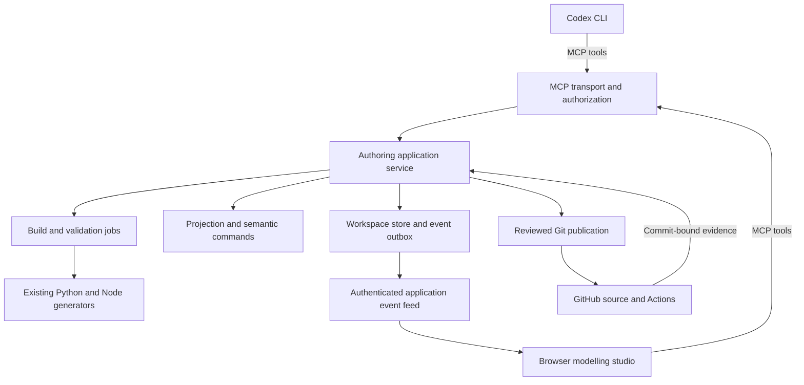
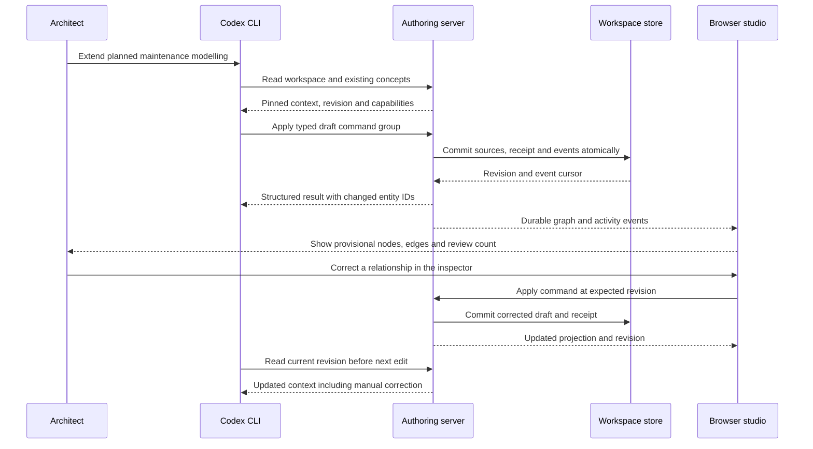
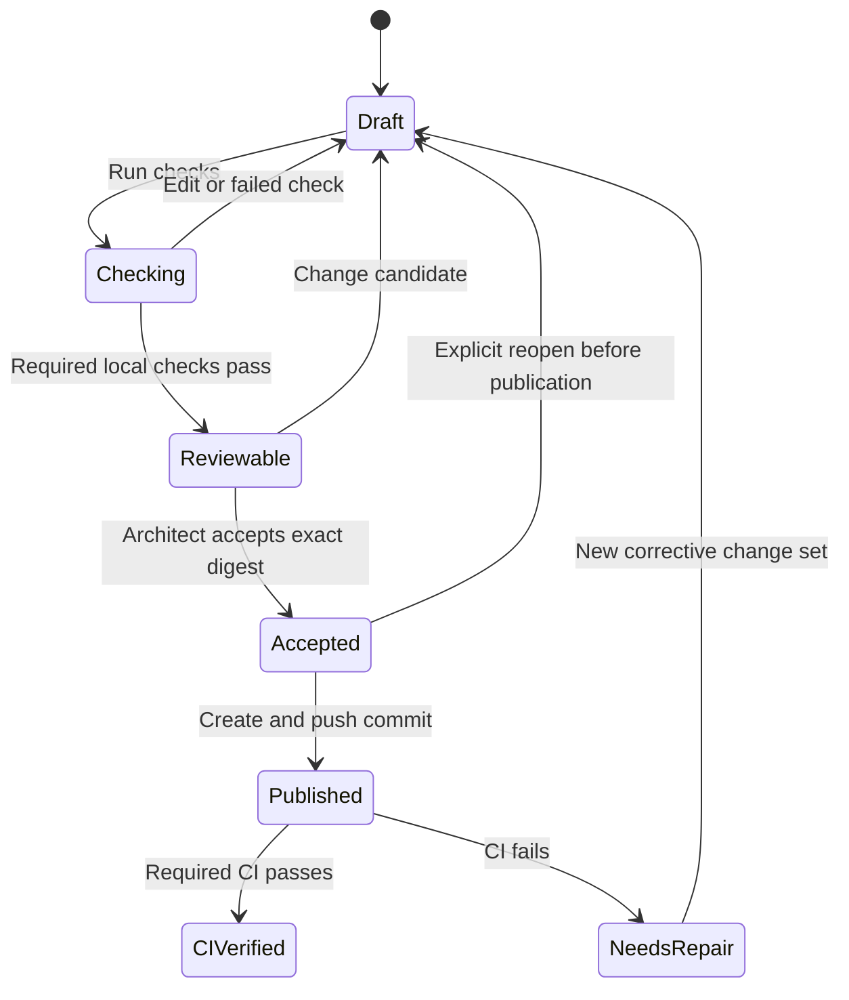

# Syntriq / ChargeWeave ontology modelling studio: MCP MVP plan

**Status:** Design for implementation; no server or modelling functionality is delivered by this document.

**Decision date:** 2026-11-01. **Canonical repository:** `pli-poc/charge-weave`.

**Inspected baseline:** [`115917aeb09a0a0023bb669a0b70f7ff1dbcc2b6`](https://github.com/pli-poc/charge-weave/tree/115917aeb09a0a0023bb669a0b70f7ff1dbcc2b6). Recheck the current source before implementation because local Codex work may have advanced it.

**Goal:** An architect describes an ontology extension in their installed Codex CLI and watches a connected browser construct, explain, validate and refine the model. The architect can intervene through normal modelling controls, review an exact change set, and publish a reproducible source change to GitHub.

**UX follow-up (2026-11-02):** The implemented prototype needs a full IDE interaction redesign. The [ontology modelling IDE UI/UX plan](ontology-modelling-ide-ux-plan.md) specifies the next implementation phases and supersedes this document's screen-layout specification where they differ. It is planned work, not a claim that the redesign or usability acceptance is complete.

## Contents

1. [Decision and MVP boundary](#1-decision-and-mvp-boundary)
2. [Repository baseline and reuse](#2-repository-baseline-and-reuse)
3. [Architecture and interaction direction](#3-architecture-and-interaction-direction)
4. [Authoritative workspace and persistence](#4-authoritative-workspace-and-persistence)
5. [MCP capability contract](#5-mcp-capability-contract)
6. [Live synchronization and recovery](#6-live-synchronization-and-recovery)
7. [Ontology source authoring and validation](#7-ontology-source-authoring-and-validation)
8. [UX principles and screen specification](#8-ux-principles-and-screen-specification)
9. [Demonstration scenario and storyboard](#9-demonstration-scenario-and-storyboard)
10. [Local installation, Codex and hosting](#10-local-installation-codex-and-hosting)
11. [Permissions, isolation and observability](#11-permissions-isolation-and-observability)
12. [Source changes and GitHub publication](#12-source-changes-and-github-publication)
13. [Implementation work packages](#13-implementation-work-packages)
14. [Verification and usability acceptance](#14-verification-and-usability-acceptance)
15. [Risks, explicit deferrals and decision gates](#15-risks-explicit-deferrals-and-decision-gates)
16. [Codex implementation handoff](#16-codex-implementation-handoff)
17. [Source references](#17-source-references)

## 1. Decision and MVP boundary

### 1.1 Final architecture decision

Build **one shared ontology-authoring service exposed as an MCP server**, initially running on the architect's computer. Codex CLI and the browser connect to that same service. The server owns the candidate ontology and its revision; the browser renders projections of that state.

This supersedes the earlier browser-only tool runtime / local CLI bridge direction for this feature. The browser remains the interactive modelling surface, but it is not the durable authority for semantic edits. Existing browser-only simulations and the published read-only ontology explorer continue to serve their existing purposes.

The two callers use the same typed operations:

- Codex discovers the tool catalogue and calls ontology tools through MCP.
- Manual browser controls call those tools through the browser MCP client.
- Every successful semantic command creates a durable change event. Connected browsers render that event, regardless of which client caused it.
- A separate application event feed provides resumable delivery to the UI. It is not a second semantic-write API.

**The MCP server does not invoke Codex.** Codex is the reasoning client that calls the server. The browser does not need to launch or automate a terminal. For the first MVP, the architect speaks to Codex in the CLI and uses the browser as the shared visual workspace. An integrated browser chat can be added later through a separate Codex app-server adapter; it is not a dependency of this MVP.

### 1.2 Product decisions

| Question | Decision |
|---|---|
| Where does the server run first? | One local Node process, bound to loopback, with a durable local workspace store and isolated build directories. |
| Which clients share it? | The existing Codex CLI and a new modelling route in the current React website. |
| Does the browser really use MCP? | Yes, for tool discovery, reads and semantic commands. It also consumes an authenticated application event stream for rendering and reconnect. |
| Where is the single model state? | The server workspace: immutable baseline sources plus a revisioned draft overlay and command history. |
| What drives React components? | Typed graph/state deltas, validation results, job status and optional view suggestions emitted after server operations. |
| Does the model return HTML or executable UI code? | No. The application selects trusted components from structured data. |
| Does each tool require another confirmation? | No. A workspace grant allows bounded draft editing. Review/publication are explicit actions over a concrete candidate. |
| Can a model publish itself? | No automatic promotion. Review authority is separate from the Codex draft-edit credential. |
| Are generated OWL/SHACL files edited directly? | No. Source commands target the owning declarative inputs and invoke the established generators. |
| Does this require a remote Syntriq deployment? | No. Prove the generic authoring boundary in ChargeWeave first. |
| Is GitHub still the shared verification authority? | Yes. Local feedback helps iteration; CI evidence is tied to the exact pushed commit. |

### 1.3 Demonstrable MVP scope

The first complete slice includes:

1. Connect both clients to one workspace and verify that they see the same baseline and draft revision.
2. Discover existing concepts, inspect their definitions and identify reuse before adding terms.
3. Propose classes, properties, relationships and supported constraints using typed commands.
4. Watch provisional additions appear on the canvas; inspect source ownership, actor and rationale.
5. Edit the same proposal manually, undo a command group, and continue in Codex against the updated revision.
6. Run fast semantic checks, deterministic generation, reference validation and positive/negative fixtures.
7. Show information, business-responsibility and temporal perspectives derived from explicit mappings.
8. Review semantic and source diffs, accept the candidate, push a described commit to GitHub and show exact-commit CI status.
9. Reload/reconnect without losing acknowledged changes or applying a command twice.
10. Repeat the demo from a fixed baseline using synthetic fixtures and a deterministic scripted MCP client.

This is a single-architect MVP supporting two or more connected clients. It is not a simultaneous multi-author merge editor. It does not need a vector database, distributed orchestration, a new ontology engine, a production registry, or an LLM API key in the browser.

## 2. Repository baseline and reuse

The design is based on source inspection, not only earlier roadmap text. Existing docs are useful context, but the code boundaries below determine the implementation work.

| Existing path | Verified current responsibility | Reuse / required change |
|---|---|---|
| `AGENTS.md` | Canonical repository, described commits, GitHub verification, source ownership and stable IRIs. | Follow throughout; preserve the established development namespace. |
| `model/domain.schema` | Line-oriented class, parent, definition, property range and cardinality source. | Primary target for structural semantic authoring. |
| `tools/build.py` | Parses the schema and generates ontology, constraints and catalogue outputs. Parsing currently executes in the script. | Extract reusable parsing/validation functions without changing existing output. Expose a bounded authoring adapter. |
| `tools/build_all.py`, `tools/extend_model.py` | Full generation sequence; reviewed extensions may mutate source before generation. | Run in isolated candidate materializations; detect any source rewrite and reconcile it before review. |
| `tools/build_rules.py`, `model/audit-rules.json` | Business-rule generation and declarative audit rules. | Support a deliberately bounded rule-template catalogue; preserve established rule IDs and generation ownership. |
| `client-runtime/src/engineering/broker.js` | Capability descriptors, grants, serialization, timeouts and invocation receipts. | Reuse the contract approach. Add server persistence and transaction semantics; in-memory receipts are insufficient for crash recovery. |
| `client-runtime/src/engineering/candidate.js` | Revision/hash-checked overlays for existing editable JSON sources; calls `JSON.parse` and cannot create arbitrary ontology source files. | Keep existing browser profile editing working. Add a separate server source workspace for the schema DSL and related files. |
| `client-runtime/src/engineering/context.js` | Curated source retrieval and dependency context. | Reuse for source-grounded discovery, with workspace/revision-aware server indexes. |
| `client-runtime/src/engineering/providers.js` | Bounded outbound MCP reads, pinned `2026-07-28`, schema checks, catalogue pinning and finite SSE response handling. | It is a client, not the requested server. Add write authorization and a proper client adapter; its 15-second buffered response path is not a durable live event feed. |
| `client-runtime/src/engineering/contracts.js` | Intentionally restricted JSON Schema validator. | Do not assume arbitrary MCP schemas are supported. Version the authoring contracts and use a pinned full validator on server ingress. |
| `client-runtime/src/engineering/coordinator.js` | Browser agent loop for existing Responses/scripted adapters. | Retain for those modes. Do not put another agent loop around Codex CLI. |
| `website/src/EngineeringWorkbench.jsx` | Test studio, candidate, context, assistant, evidence and providers UI. | Reuse shell/components where useful; add an integrated modelling workspace rather than another disconnected editor. |
| `website/src/Ontology.jsx`, `model-utils.js`, `ontology.css` | Explorer, relationships, inspector, triples and temporal presentation. | Extract reusable display components. Inject a provider; do not mutate its imported static model globals for a live draft. |
| `website/src/model/provider.js` | Hash-checked immutable static model packages. | Keep for published browsing. Add an authoring snapshot adapter for draft modelling. |
| `docs/semantic-modeler-roadmap.md` | Projection-based visual modelling; React Flow/ELK direction and semantic/presentation separation. | Carry forward those principles with explicit semantic commands in this MVP. |
| `client-runtime/src/compiler/application.js` | Browser compiler for application profiles. | Consume newly generated compatible catalogue/profile inputs; it is not a full OWL/SHACL compiler. |
| `ai-relay/` | Existing credential-holding Responses relay. | Not required for the Codex CLI path; do not repurpose it as a second ontology authority. |
| `.github/workflows/ontology-ci.yml` | Full semantic verification and packaging. | Preserve all gates; extend with authoring parity tests. |
| `.github/workflows/website-pages.yml` | Runtime/browser checks and generated public artifact publication to `charge-weave-app`. | Add server/browser integration checks and new path triggers when implementation begins. |

The `charge-weave-app` repository is the generated deployment target. Source work and this plan belong in `charge-weave`.

Related design documents: [engineering workbench](engineering-workbench-architecture.md), [delivery ledger](engineering-workbench-status.md), [semantic modeler](semantic-modeler-roadmap.md), [model provider](model-provider.md), [temporal contract](temporal-contract.md), [development](development.md). This plan refines their authoring integration; it does not mark previously planned work as implemented.

## 3. Architecture and interaction direction

### 3.1 Component topology



These are modules inside one service, not separate deployments. The generic authoring service takes a registered domain adapter. ChargeWeave supplies the namespace, source locations, generator jobs, requirement mappings and demo fixtures.

The MCP transport delegates to application services. The same application services construct events and enforce permissions. Business rules must not be implemented independently in HTTP handlers, tool handlers and React callbacks.

### 3.2 One edit from intent to visible graph



The terminal receives a result; it does not need to receive every UI event. The browser receives changes from every authorized client. A request's MCP progress messages do not, by themselves, broadcast that change to another client's canvas.

### 3.3 Protocol boundaries

Use a maintained MCP SDK and pin a version tested with the installed Codex client. The repository currently pins MCP `2026-07-28` in its outbound adapter; do not assume the user's installed CLI implements the same revision. P0 must demonstrate real discovery and a structured call with both clients.

For the `2026-07-28` protocol, HTTP requests are request-scoped and long-lived protocol notifications use `subscriptions/listen`; older session/GET-stream assumptions must not be mixed into that path. This project deliberately keeps durable UI replay in its own versioned event API. If compatibility requires an older supported MCP revision, isolate it in the transport adapter and test it; application workspace IDs remain unchanged. [S1, S2]

Use these application endpoints, proposed names rather than existing routes:

| Endpoint | Purpose | Writes semantic state? |
|---|---|---|
| `POST /mcp` | MCP discovery and tool calls; SDK handles compatible protocol framing. | Only through authorized command tools. |
| `GET /studio/` and assets | Serve the built modelling UI from the same local origin. | No. |
| `POST /auth/pair` | Exchange a short-lived, one-use local pairing code for a browser session. | Authentication state only. |
| `GET /api/workspaces/:id/events?after=:cursor` | Fetch-streamed SSE with application replay cursor. | No. |
| `GET /api/jobs/:id/artifacts/:artifactId` | Bounded authenticated reports/downloads. | No. |
| `GET /health` | Minimal liveness/version; no file paths or model contents. | No. |

The event route is **application SSE**, with its own contract and replay guarantees. Do not label it MCP SSE or claim that MCP itself supplies our event history. Browser semantic reads still use MCP tools, including snapshot recovery.

## 4. Authoritative workspace and persistence

### 4.1 State ownership

| State | Authority | Browser treatment |
|---|---|---|
| Published model sources | Git commit in the canonical repository. | Immutable baseline. |
| Candidate sources and semantic command history | Server workspace store. | Read model updated from events/snapshots. |
| Generated model package | Immutable build artifact derived from an exact source digest and toolchain. | Render with its provenance. |
| Provisional structural graph | Server parser/projection over current candidate sources. | Display as draft before reference checks finish. |
| Validation evidence | Job output bound to input digest and toolchain version. | Never reuse as current evidence after relevant edits. |
| Saved viewpoints and annotations | Versioned presentation records in the workspace; exportable view manifests. | Editable separately from semantics. |
| Selection, viewport and expanded panels | Per-browser local preference. | Never overwritten by an agent without follow mode. |
| Connection state and event cursor | Browser memory plus recoverable cursor. | Cache is not a second ontology store. |

Use SQLite as the initial transactional store behind a storage port. Choose and pin the concrete Node driver in P0 after a Windows/Linux smoke test. A single database transaction writes the new source overlay, workspace revision, command receipt, audit entry and outbox events. Filesystem build directories are materializations, not the transaction authority.

### 4.2 Identity model

Every tool result and event includes enough identity to prove which model it describes:

| Field | Meaning |
|---|---|
| `workspaceId` | Stable server-issued ID, explicitly selected by each client. |
| `baselineCommit` | Git source commit imported at workspace creation. |
| `sourceDigest` | SHA-256 over a canonical, path-sorted manifest of candidate source bytes and adapter version. |
| `revision` | Monotonic semantic revision within the workspace; increments on accepted draft mutations. |
| `changeSetId` | One user intent grouping multiple commands and its review lifecycle. |
| `operationId` | Caller-generated idempotency key for one request. |
| `eventSequence` | Monotonic per-workspace committed event cursor, including non-semantic events. |
| `viewRevision` | Separate presentation revision; moving a node does not increment semantic revision. |
| `artifactDigest` | Digest of generated artifacts; distinct from the source digest. |
| `jobId` / `evidenceId` | Server-issued references to checks and their immutable inputs. |

Do not reuse the existing browser candidate digest ambiguously: `candidate.js` currently changes digest meaning between source overlay and compiled package. The new boundary names source and artifact digests separately and adapts to existing consumers explicitly.

### 4.3 Proposed persisted records

| Record | Minimum content |
|---|---|
| Workspace | ID, domain adapter, namespace, baseline commit, source digest, revision, state, created/updated times. |
| Source blob | Content hash, UTF-8 bytes, media type, bounded size; immutable and deduplicated. |
| Workspace source | Allowed relative path, baseline blob, current blob, source owner, edit capability. |
| Change set | Intent, affected requirements, commands, base/current revisions, status, review metadata. |
| Command receipt | Workspace + actor + operation ID, request digest, result, applied revision and event range. |
| Event outbox | Sequence, event ID, type, payload, correlation/causation, actor and server timestamp. |
| Validation job | Input digest, immutable source manifest, job type, status, progress, exit code, evidence references. |
| Review decision | Reviewed digest, baseline commit, evidence IDs, actor, time, warning acknowledgements. |
| Saved view | Projection mapping version, root/filter, pinned node positions, groups, annotations, view revision. |
| Publication | Reviewed digest, branch, commit, push state, CI run IDs and conclusions. |

Persist actor identity from the authenticated request, not from a model-supplied `author` argument. The MVP records local audit history; it does not claim tamper-proof independent audit evidence against the owner of that machine.

### 4.4 Mutation transaction

1. Authenticate and authorize the caller for this workspace and command class.
2. Validate the full request, sizes, command types, paths and referenced IDs.
3. Look up the operation receipt. Same operation ID and request digest returns the prior result; a different payload under that ID is rejected.
4. Check `expectedRevision`, source preconditions and workspace lifecycle state.
5. Apply the command group to an isolated in-memory candidate, then parse and run fast structural checks.
6. Compute the complete source manifest and minimal graph delta.
7. Commit candidate, revision, receipt, audit and outbox in one transaction.
8. Return the committed identity and event range; dispatch the outbox asynchronously.

Never acknowledge a write before persistence. Delivery is at least once; semantic effects are deduplicated by receipts. Do not promise network-level exactly-once delivery. A failed group leaves no partial source edits.

One change set is active for semantic editing in an MVP workspace. A workspace may have historical accepted/rejected sets. Multiple independent proposals use separate workspaces; merging arbitrary concurrent branches is deferred.

### 4.5 Lifecycle and recovery



Job state is separate from change-set state. Editing while a job runs marks its future result as evidence for the older revision; the UI must not silently apply it to the latest revision. A publication in progress freezes its accepted manifest, even if a separate workspace continues editing.

Server restart restores durable drafts, receipts and events. Incomplete jobs become `interrupted` until inspected/restarted. Publication recovery checks Git commit/ref state before retrying a push; it never creates duplicate commits because a response was lost.

## 5. MCP capability contract

### 5.1 Catalogue design

Expose useful modelling operations, not arbitrary filesystem or shell tools. Keep the initial catalogue bounded and stable. Use the same JSON Schemas for the MCP catalogue, browser forms, server validation and contract tests. Tool annotations describe behavior but do not grant authority.

All workspace-scoped tools require `workspaceId`; there is no mutable server-global active workspace. Reads return a pinned identity. Mutations require `expectedRevision` and `operationId`. Client-selected labels or focus hints cannot change permissions.

| Tool | Essential input | Structured output / behavior | Authority |
|---|---|---|---|
| `ontology_workspace_list` | Optional filter/cursor. | Authorized workspaces, baseline and revision. | Read. |
| `ontology_workspace_create` | Domain adapter, allowlisted repository, baseline ref, title, operation ID. | New pinned workspace; never changes the caller's checkout. | Workspace create. |
| `ontology_workspace_get` | Workspace ID. | Identity, active change set, capability limits and freshness. | Read. |
| `ontology_context_search` | Workspace, query, module/kind, bounded limit/cursor. | Candidate reuse matches with definition, IDs and source refs. | Read. |
| `ontology_entity_get` | Workspace, entity IRI, optional expected revision. | Definition, inherited/declared fields, relationships, rules and provenance. | Read. |
| `ontology_view_get` | Workspace, viewpoint, root IDs, filters, depth, limit, optional expected revision. | Normalized graph, explicit mappings, omitted count and identity. | Read. |
| `ontology_changeset_open` | Workspace, expected revision, operation ID, intent and requirement refs. | Change-set ID and editable scope. | Draft edit. |
| `ontology_changeset_apply` | Workspace, change set, expected revision, operation ID, typed commands and rationale. | Atomic source/semantic delta, current identity and affected IDs. | Draft edit. |
| `ontology_changeset_diff` | Workspace, change-set ID, optional expected revision. | Semantic diff, source diff references, impact and compatibility warnings. | Read. |
| `ontology_changeset_undo` | Workspace, expected revision, operation ID, target command group. | A new revision restoring the group's effects if preconditions hold. | Draft edit. |
| `ontology_validation_start` | Workspace, exact source digest/revision, check profile, fixture set, operation ID. | Durable job ID; returns promptly. | Validate. |
| `ontology_job_get` | Workspace, job ID, log cursor. | State, bounded progress, evidence and immutable input identity. | Read. |
| `ontology_job_cancel` | Workspace, job ID, operation ID. | Cooperative cancellation request and eventual outcome. | Own job / permitted job control. |
| `ontology_evidence_get` | Workspace, evidence ID, optional expected digest. | Check scope, assertions, reports and source/fixture identity. | Read. |
| `ontology_view_suggest` | Workspace, entity IDs, viewpoint, explanation and operation ID. | Nonbinding focus/perspective suggestion, visible in activity. | Suggest view. |
| `ontology_view_save` | Workspace, view ID, expected view revision, presentation definition, operation ID. | Saved layout/mapping references; semantic revision unchanged. | View edit. |
| `ontology_changeset_review` | Workspace, digest, evidence IDs, decision, optional warning acknowledgements, operation ID. | Digest-bound acceptance/rejection record. | Reviewer credential. |
| `ontology_publication_start` | Workspace, accepted digest, expected base commit, branch policy, described commit message, operation ID. | Publication job ID and eventual GitHub links. | Publisher credential. |

Also implement versioned MCP resources for bounded read access, for example `ontology://workspace/<id>/summary`, `/entity/<encoded-iri>`, `/evidence/<id>` and `/changes/<id>`. Tools remain sufficient for clients that do not use resources. Resource URI possession never grants access. Optional MCP prompts may provide a modelling checklist; they do not encode state or silently approve changes.

### 5.2 Typed semantic commands

`ontology_changeset_apply` accepts a discriminated list of domain commands. Begin with:

| Command | Contract and restrictions |
|---|---|
| `class.add` | New local name, existing module, parent, definition; reject duplicates and invalid identifier characters. |
| `class.describe` | Update definition/display metadata; stable IRI remains unchanged. |
| `property.add` | Owning class, local property name, supported datatype or object target, cardinality and definition metadata. |
| `property.update` | Explicit existing field precondition; range/cardinality changes carry compatibility classification. |
| `relationship.add` | Typed convenience command compiling to an object property declaration; never infer semantics from a drawn line. |
| `constraint.add` | Reference a supported template and validated parameters; compile to its source owner. |
| `requirement.link` | Link declared requirement/acceptance case to changed terms without inventing requirements coverage. |
| `temporal.policy_set` | Set a supported, explicit policy through the existing temporal source conventions. |
| `viewpoint.binding_add` | Add an explicit presentation mapping/reference without inventing a business relationship. |

Hard deletion and IRI renaming are excluded from the first guided MVP. Mark the unsupported action and explain the required migration. Undo of a newly introduced draft element is supported. Display-label edits must never rename an IRI.

The MVP can tighten a constraint in a draft, but must show affected examples and a breaking-change warning. Cross-module dependencies are computed before acceptance. Arbitrary OWL axioms, executable Python, arbitrary JavaScript and unrestricted SPARQL update are not accepted as model-generated commands.

### 5.3 Example draft mutation

The following is a **proposed application payload**, not a claim that this tool exists. MCP wire framing is supplied by the pinned SDK.

```json
{
  "workspaceId": "ws-maintenance-demo",
  "changeSetId": "cs-maintenance-window",
  "expectedRevision": 7,
  "operationId": "op-maintenance-group-01",
  "rationale": "Represent a planned maintenance interval separately from its work order.",
  "commands": [
    {
      "type": "class.add",
      "localName": "PlannedMaintenanceWindow",
      "module": "operations",
      "parent": "Record",
      "definition": "A planned interval of maintenance affecting a charging station."
    },
    {
      "type": "relationship.add",
      "owner": "PlannedMaintenanceWindow",
      "property": "maintenanceStation",
      "target": "ChargingStation",
      "cardinality": "!"
    },
    {
      "type": "relationship.add",
      "owner": "PlannedMaintenanceWindow",
      "property": "maintenanceInterval",
      "target": "TimeWindow",
      "cardinality": "!"
    }
  ]
}
```

Local names above resolve inside the workspace's pinned namespace. Transport schemas may use full IRIs for references internally; normalize once at the boundary. Global property collisions must be checked before accepting these illustrative names.

### 5.4 Result envelope and errors

Every successful application result includes `contractVersion`, `workspaceId`, `revision`, `sourceDigest`, `data`, `warnings`, `evidenceRefs`, `eventRange` and `nextActions`. Use `structuredContent` for machine consumption and a short text summary for clients that render text. Reference large artifacts by authenticated handles, not giant text responses. [S3]

For a mutation, `data` includes `commandGroupId`, `changedEntityIds`, `addedEdgeIds`, `removedEdgeIds`, `affectedSourcePaths`, `validationFreshness` and `reviewState`. Preview hints contain only allowlisted view/entity identifiers. They cannot contain scripts, CSS, HTML or unrestricted navigation URLs.

| Error code | Meaning | Recovery displayed to architect / Codex |
|---|---|---|
| `REVISION_CONFLICT` | Another accepted edit moved the workspace. | Read current revision and diff; replan or explicitly reapply. No automatic overwrite. |
| `IDEMPOTENCY_CONFLICT` | Same operation ID used for different content. | Inspect original receipt; use a new operation ID for a new action. |
| `UNKNOWN_TERM` | A reference is absent at the pinned revision. | Show nearby candidates; do not invent a target. |
| `DUPLICATE_TERM` | New term collides with an existing identity. | Inspect reuse/rename of the proposal. |
| `PROPERTY_TYPE_CONFLICT` | Global property identity is incompatible with requested kind/range. | Show other owners and actual semantic consequences. |
| `UNSUPPORTED_SEMANTICS` | Requested axiom/rule lies outside implemented templates. | Keep draft intent visible and identify an implementation extension. |
| `CHECKS_STALE` | Evidence belongs to another source digest. | Rerun required checks for this revision. |
| `REVIEW_REQUIRED` | Publication lacks an eligible digest-bound review. | Open the review panel. |
| `SCOPE_DENIED` | Credential lacks the required permission. | Show which action is unavailable; do not expose secrets or another workspace. |
| `BUILD_FAILED` | Generator/reference job failed. | Link diagnostic, input digest and affected source. |
| `REPLAY_EXPIRED` | Browser event cursor is older than retained history. | Load a fresh consistent snapshot and reconnect. |

Separate MCP protocol errors from application failures. Never convert a timeout, cancellation, unsupported check or empty result into success.

## 6. Live synchronization and recovery

### 6.1 Application event contract

The outbox publishes a versioned application envelope:

```json
{
  "eventVersion": 1,
  "workspaceId": "ws-maintenance-demo",
  "eventId": "evt-000124",
  "sequence": 124,
  "type": "model.delta",
  "revision": 8,
  "sourceDigest": "<sha256-of-source-manifest>",
  "operationId": "op-maintenance-group-01",
  "changeSetId": "cs-maintenance-window",
  "actor": { "kind": "agent", "displayName": "Codex" },
  "occurredAt": "2026-11-01T14:00:00.000Z",
  "payload": {
    "addedEntityIds": ["https://example.org/charge-domain#PlannedMaintenanceWindow"],
    "updatedEntityIds": [],
    "removedEntityIds": [],
    "projectionInvalidations": ["information", "responsibility", "temporal"]
  }
}
```

The actual contract must define complete typed node/edge records or a bounded invalidation/refetch strategy. Start with small deltas for loaded entities and revision-pinned projection refetch for expanded neighborhoods. Do not concatenate guessed triples in the browser.

| Event | UI behavior |
|---|---|
| `workspace.snapshot_available` | Baseline/import readiness; load the first projection. |
| `command.started` | Activity row displays a bounded operation description; no semantic mutation implied. |
| `model.delta` | Update normalized entity/edge cache and changed-state badges. |
| `command.completed` | Mark the activity row complete and show changed entity count. |
| `command.failed` | Show error and recovery action; preserve the previous graph. |
| `validation.started/progress/completed` | Update the relevant revision's check cards and issues. |
| `view.suggested` | Offer “Show change”; follow automatically only when enabled. |
| `review.changed` | Update accepted/rejected state for an exact candidate digest. |
| `publication.changed` | Show prepared, committed, pushed, CI pending, passed or failed. |
| `workspace.access_revoked` | Stop semantic actions and stop receiving protected payloads. |

`command.started` and job events may be durable activity records, but only the atomic mutation commit advances semantic revision. Event sequence must not be mistaken for semantic revision.

### 6.2 Race-free initial load

1. Browser calls `ontology_workspace_get` and `ontology_view_get` against a consistent revision. The snapshot carries the last committed event sequence included in that view.
2. Open the event feed with `after=<snapshotSequence>`.
3. Server replays subsequent retained events in order before streaming live events; the handoff uses the same log cursor and cannot skip a commit.
4. Browser applies sequences once, ignores duplicates and detects gaps.
5. On a gap or expired cursor, reload the snapshot. Preserve local viewport/selection for IDs that still exist.

A projection request with an obsolete expected revision either uses a retained immutable snapshot or returns `REVISION_CONFLICT`; it must not quietly combine revisions. The initial MVP may choose current-only projection reads and bounded retry instead of retaining every parsed graph.

### 6.3 Interruption behavior

| Condition | Required behavior |
|---|---|
| Lost mutation response after server commit | Retry with the same operation ID; return its stored receipt and result. |
| Browser disconnect | Server keeps workspace; header says “Reconnecting”; disable new semantic submissions until state is reconciled. |
| Codex disconnect | In-progress committed edits remain visible. No automatic second agent is started. |
| Server restart | Reopen durable workspace, resume event replay, identify interrupted jobs and reconcile publication. |
| Late tool result | Keep it in history with its revision; never roll the canvas back to that revision. |
| Browser manual edit during Codex work | Serialize commands; a stale Codex write receives a conflict and refreshed context. |
| Two browser tabs | Each has its own viewport. Both see shared semantic events; server revision checks prevent lost updates. |
| Cancel before mutation commit | Abort if possible and return no semantic effect. |
| Cancel after commit | Report the committed effect; provide an undo action. Cancellation is not a transaction rollback promise. |
| Browser background throttling | Fetch latest snapshot on resume if behind; coalesce visual updates without losing semantic events. |

Use a heartbeat and bounded exponential reconnect backoff with jitter. Proposed starting values: heartbeat 15 seconds; reconnect from 0.5 seconds to 10 seconds; keep the full event log for active MVP workspaces, with explicit retention/compaction later. Store a durable snapshot before event compaction. An event queue overflow forces snapshot recovery, not silent event dropping.

### 6.4 Browser render pipeline

`MCP snapshot / application events → normalized workspace store → viewpoint selector → graph delta → React components`.

Use stable semantic IDs and memoized selectors. Apply one committed command group per visual frame; do not animate token-by-token model text into graph mutations. Compute layout in a Web Worker. Ignore a layout result if its graph/view revision no longer matches the current projection.

Keep existing node positions fixed where possible. Lay out newly added nodes in the affected neighborhood. Full auto-layout runs only on explicit request or first view load. Selection remains on the same semantic entity across perspectives, and cross-perspective inspectors resolve the same IRI.

## 7. Ontology source authoring and validation

### 7.1 Canonical write path

The authoring service edits the owning source, then generates derived artifacts through the existing toolchain. It does not update browser JSON and call that an ontology extension.

For class/field changes:

1. Import a clean baseline source manifest from an exact Git commit.
2. Refactor the existing Python schema parser into a reusable module with round-trip/parity tests.
3. Build a structured AST retaining source locations, module sections, comments and original text for unchanged declarations.
4. Apply typed commands through a bounded Python adapter, with JSON input/output and fixed executable/arguments supplied by the service.
5. Return the source patch, normalized semantic description, diagnostics and source references.
6. Commit the candidate source manifest and event outbox.
7. Materialize that manifest in an isolated build directory when generation is requested.
8. Run the existing generators and load their resulting catalogue, RDF and validation evidence.

The browser does not implement a competing canonical DSL parser. Fast form validation checks obvious input mistakes; the server parser decides whether a source edit is admissible. Extract the reusable parser before adding novel syntax.

`tools/build_all.py` invokes `extend_model.py`, which can amend source inputs. Therefore compare the source manifest before and after generation. If a generator changes source bytes, surface and incorporate those changes into a new draft revision before review, or eliminate the unintended rewrite through an explicitly tested refactor. Never attach a passing report to the pre-generation digest when a different source was validated.

### 7.2 Semantic correctness rules

- Preserve `https://example.org/charge-domain#` and current term identity. Brand labels do not authorize a namespace migration.
- Respect the current schema's `!`, `?`, `+`, `*` cardinalities. Show them as Exactly one, Optional, One or more, Zero or more; arbitrary numeric bounds need a separate supported constraint template.
- Distinguish inherited fields from declared fields. Editing an inherited property requires an explicit owner change and impact preview.
- Object properties reference existing class identities. Validate global property kind/range use across the whole model, not just the selected node.
- Reject duplicate class IDs, inheritance cycles and unresolved targets. Show datatype and controlled-vocabulary consequences.
- Reuse existing `TimeWindow`, `Principal`, `LegalEntity`, `WorkOrder` and similar concepts when their meanings fit. Search before creating a near-duplicate.
- Separate ontology schema versions from business-time validity and knowledge-time history. A draft revision is not a `TemporalCommit` business snapshot.
- A field named `validFrom` does not establish a complete bitemporal contract. The temporal perspective shows the applicable policy and any missing mapping.
- Business responsibility, access authorization and record ownership are distinct relationships; placing a role near a process does not create one.
- New classes need positive fixtures, temporal coverage and appropriate requirement/test traceability. Existing all-class positive coverage must remain intact.
- Introducing a new rule requires a deliberate violating case and a positive or boundary counterpart. Rule IDs cannot be allocated from a stale hard-coded “next number.”

### 7.3 Supported rule authoring

The first MVP supplies a finite template registry with schema, description, source owner, compiler and test factory. Start with required relationship, supported range/cardinality, allowed-value set and valid interval checks where the current model can represent them faithfully. Existing shared rules should be reused rather than duplicated for every new class.

Rules requiring fresh SHACL-SPARQL bodies may be drafted as explicit source proposals, but promotion requires parser validation, prohibited-operation checks, positive/negative fixtures, timeout limits and full reference execution. Do not execute user-supplied Python or dynamically evaluate model text. Python-only generator extensions remain code work outside the no-code modelling subset.

Before promising a template, prove that it compiles through `build_rules.py` and preserves its existing behavior. A “not supported yet” diagnostic is preferable to silently reducing an invariant to a decorative badge.

### 7.4 Validation tiers

| Tier | Runs where / when | Checks | Display |
|---|---|---|---|
| Input | Browser and server, before dispatch/apply. | Required fields, size/shape, allowed command/template. | Inline error near the field. |
| Structural draft | Server parser, per command group. | Identity, targets, inheritance, property kind and supported cardinality. | “Draft checks passed” or linked issue. |
| Generated candidate | Isolated local job. | Generation, source drift, catalogue/RDF coherence, compatible application profile build. | “Generated for revision N.” |
| Reference | Existing Python/Java/Node checks on immutable materialization. | SHACL, OWL, business rules, temporal coverage, traceability, fixtures and impacted regressions. | Exact job/check results with digest. |
| Repository | GitHub Actions on pushed commit. | Full established gates plus new authoring/server/browser checks. | “CI passed” only for matching commit and evidence. |

Validation start returns a job immediately; clients observe progress through job reads/events. A read-only concept query must remain responsive while Python checks run. Use a bounded job queue (one heavy build per local workspace initially), process timeouts, output limits and cancellation. Runtime simulations retain their separate evidence scope.

### 7.5 Projection and view contract

```json
{
  "viewId": "maintenance-information",
  "viewpoint": "information",
  "mappingVersion": "chargeweave-authoring-v1",
  "rootIds": ["https://example.org/charge-domain#PlannedMaintenanceWindow"],
  "depth": 1,
  "filters": { "includeInherited": false, "changesOnly": false },
  "positions": {},
  "pinnedIds": [],
  "groups": [],
  "annotations": []
}
```

Graph nodes contain stable IRI, semantic kind, label, module, source refs and change status. Edges contain stable owner/property/target identity, semantic predicate, cardinality and mapping provenance. Presentation-only annotations use a separate ID space.

Initial perspectives:

| Perspective | What it answers | Required semantic basis |
|---|---|---|
| Information | What concepts exist and how are they related? | Class/field/inheritance and object-property declarations. |
| Responsibility | Who is accountable, affected, executing or approving? | Explicit role/party/responsibility relationships and versioned mappings. |
| Temporal | What interval/version does this concept describe? | Existing time fields, referenced windows and temporal policy. |
| Change impact | Which sources, requirements, queries, rules and views are affected? | Indexed explicit dependencies, with unknown/dynamic dependencies marked. |

A process/journey lens may embed existing XFlow references if the extension is actually bound to a workflow. The MVP must not generate a pretend executable workflow merely because an ontology includes a work order.

## 8. UX principles and screen specification

### 8.1 Interaction principles

1. **The model is the main surface.** The architect can understand the extension without reading a terminal transcript.
2. **Show the next useful action in context.** “Inspect target,” “Fix constraint,” “Show change” and “Review 4 changes” belong near the affected object.
3. **Draft editing is fluid.** A granted session can accumulate reversible changes without a modal for each field.
4. **Keep the mental map stable.** Agent activity never unexpectedly resets zoom, selection or node placement.
5. **Show actual outcomes.** Distinguish proposed draft, generated model, checked model, accepted change and published commit.
6. **One selection across panels.** Canvas, term list, inspector, source diff and issue list resolve the same semantic identity.
7. **Expose technical detail progressively.** Business descriptions first; IRI, triples and source files are available under Details.
8. **Manual and agent editing are equal.** Both issue identical commands and produce the same provenance.
9. **Recover in place.** Errors identify what failed and offer a specific repair while preserving context.
10. **Avoid fabricated AI activity.** Show tool calls and supplied explanations, not hidden reasoning or invented progress percentages.

### 8.2 Shell and density

Add `/developer/modeler/` to the existing website routing, respecting its configured base path. The local service serves that built route under its own origin. Preserve a clear link from the existing engineering workbench and ontology explorer.

Use the current ChargeWeave branding, typography, color tokens and inspector language. Implement a compact full-height workspace with no marketing hero or large exterior margins. Do not redesign the rest of the site in this milestone.

| Region | Desktop default | Content |
|---|---|---|
| Top workspace bar | About 48–56 px. | Workspace name, baseline/draft status, connection badge, Run checks, Review. |
| Left navigator | About 240 px, resizable/collapsible. | Search, modules, terms, recent changes and saved views. |
| Main canvas | Flexible; gets the largest area. | Semantic graph, context actions, zoom/fit, perspective selector and minimap when useful. |
| Right inspector | About 320 px, resizable/collapsible. | Definition, properties, relationships, rules, provenance for the selected term. |
| Bottom activity / issues tray | Closed or about 200 px when opened. | Agent actions, validation issues, jobs and connection diagnostics. |
| Review surface | Dedicated split view within the workspace. | Semantic diff, source patch and acceptance controls. |

At 1280×800, keep the canvas usable by collapsing a side panel rather than forcing horizontal scrolling. At 1920×1080, support a recording view with stable panel sizes and clear text. Below about 1024 px, prioritize search, inspect and review; use drawers for panels. Full graph authoring is a desktop-first target, with an accessible list equivalent on smaller screens.

### 8.3 Screen S01 — Connect and choose a workspace

**Entry:** Open the local studio, or choose “Model with Codex” from the existing workbench.

**Visible:** Server availability, concise pairing form if needed, workspace list, baseline revision, last activity, and “Create workspace.” The welcome explains the intended arrangement in one sentence: “Use Codex to propose changes; inspect and refine them here.”

**Actions:** Connect/pair; create from a repository commit; open a workspace; copy the workspace ID; inspect the Codex connection snippet. Endpoint/configuration details belong in a collapsible connection panel.

**States:** Service unavailable, pairing expired, connected, workspace loading, missing compatible client version. Failures offer an exact local startup instruction, never repeated anonymous reconnect attempts.

**Acceptance:** Codex and browser show the identical workspace ID, baseline commit and revision before editing begins. A different selected workspace is clearly visible, not silently redirected.

### 8.4 Screen S02 — Model overview and discovery

**Visible:** Module navigator, search, current perspective, graph neighborhood and a concise model summary. Start from a selected concept or module, not an unreadable graph of every class.

**Actions:** Search terms and synonyms; inspect definition; expand neighbors; focus one relation; toggle inherited fields; open saved view. Search results include module, kind and short definition so similar names can be distinguished.

**States:** Loading; no search match; ambiguous concepts; filtered view with omitted count. Empty results offer “Search related concepts” before “Create concept.”

**Acceptance:** Existing `ChargingStation`, `WorkOrder`, `TimeWindow` and `AvailabilityPolicy` are discoverable from real model data. Selecting a result focuses the same entity in canvas and inspector.

### 8.5 Screen S03 — Live assisted modelling

**Visible:** Main canvas, change counter and compact activity tray. Agent edits add labelled draft nodes and relationships. Each action says what changed, for example “Codex added PlannedMaintenanceWindow and 2 relationships.”

**Actions:** Follow agent on/off; Show latest change; Pause following; open rationale; select a changed entity; undo the last command group; run checks. “Pause following” affects camera movement, not the underlying modelling task. Stopping Codex's reasoning is done in the CLI in this MVP; the UI must not show a nonfunctional Stop agent button.

**Visual semantics:** Added = positive accent plus `Added` label; changed = warm accent plus `Changed`; removed draft proposal = dashed/tombstone representation in the diff. Never rely on color alone. Existing context remains subdued but readable.

**Camera rule:** Default follow mode highlights additions without recentering while the architect is interacting. An explicit Follow toggle may focus subsequent groups. Manual pan/selection suspends automatic camera movement and exposes a “Resume following” control.

**Acceptance:** A real MCP call from Codex becomes visible without refresh. The graph does not continuously reshuffle, and activity shows actual tools and results rather than streamed internal reasoning.

### 8.6 Screen S04 — Concept inspector and inline authoring

**Tabs/sections:** Overview, Fields, Relationships, Constraints, History/Source. Keep a short business definition visible above technical details.

**Field editor:** Clear label, local name, supported datatype/object target, cardinality dropdown, help and validation. Target search uses actual classes. Show inherited versus declared fields and warn before changing a globally reused property.

**Relationship gesture:** Drag from a node connector to a target opens a compact form for predicate name, cardinality and description. Submission creates a semantic command; dragging alone is not an ontology edit. Offer the same action from a keyboard-accessible menu.

**States:** Editing, submitting, saved at revision N, inline error, stale revision. Do not toast every keystroke. Submit an explicit field action or coherent debounced form save with visible state; never send half-entered names as semantic commands.

**Acceptance:** A manual edit is visible to Codex's next read. Cancel leaves no change. Label-only edits keep the IRI. Moving a node changes only view state.

### 8.7 Screen S05 — Business responsibility and temporal perspectives

**Visible:** Same selected concept in a viewpoint tailored to responsibility or time. Show roles/parties around a central maintenance concept using explicit semantic mappings. Include a compact legend explaining the predicates.

**Actions:** Switch perspective, inspect a role binding, trace why a relationship is displayed, filter operational versus ownership responsibilities, inspect a referenced `TimeWindow` and temporal policy.

**States:** Complete mapping, partial mapping, no explicit binding. Missing evidence is shown as “No responsibility binding defined” with an authoring action, not a guessed edge.

**Acceptance:** Every semantic node/edge traces to an IRI/source or an explicit mapping. Layout groups are not mistaken for ontology facts. Temporal view separates model version from business valid/known time.

### 8.8 Screen S06 — Validation and guided repair

**Visible:** Check cards grouped by tier, job progress, exact revision checked, and an issue list with severity, affected entity, plain-language cause and check reference.

**Actions:** Run draft checks; run reference checks; select issue to focus graph/field/source; copy a focused repair instruction to Codex; retry/cancel a job; inspect evidence.

**Example:** “The maintenance window has no station. Exactly one ChargingStation is required.” A fixture violation is labelled as a fixture result, distinct from a malformed class definition.

**States:** Not run, queued, running, passed, failed, stale, cancelled, interrupted and unavailable. A deliberately failing negative fixture is a passing test only if the expected rejection is actually observed.

**Acceptance:** One deliberate failure can be found, explained and corrected without leaving the workspace. Old passing results become visibly stale after an edit. No green overall badge appears while a required tier is missing.

### 8.9 Screen S07 — Change review

**Visible:** Left: semantic changes grouped by concept and intent. Center: before/after definitions and relationships. Optional right/source tab: exact owning-source patch and generated artifact summary. Above: source digest, baseline, check freshness and impact summary.

**Actions:** Inspect a change; navigate to the affected graph; accept the complete change set; reject/reset draft; return for refinement; acknowledge an eligible warning with a reason.

MVP acceptance is whole-change-set to preserve dependencies. If an architect wants only part, remove/undo commands in the draft and rerun checks. Do not offer a checkbox that accepts a relationship without its required new target class.

**Acceptance:** The acceptance action binds the exact source digest, baseline and evidence. Any semantic edit invalidates acceptance. No review approval appears in the Codex tool catalogue for its draft credential.

### 8.10 Screen S08 — Publish and repository evidence

**Visible:** Exact files to commit, descriptive commit subject/body, target branch policy, baseline/head comparison, local validation summary and pending GitHub CI state.

**Actions:** Publish reviewed change; open commit/PR; inspect check results; repair a failed check in a new change set. Publication control is available only to the reviewer/publisher session.

**States:** Preparing patch, stale repository base, commit created, push pending, pushed, CI running, CI failed, CI passed. Distinguish pushed source from deployed site artifact.

**Acceptance:** All intended source/generated/test changes are included; secrets and machine files are excluded. A successful push returns a real GitHub URL. Branch protection results in a reviewable PR, never a force push.

### 8.11 Screen S09 — History and reconnect

**Visible:** Chronological command groups with actor, time, intent, revision, checks and publication. Selecting history overlays a read-only historical comparison without modifying the current candidate.

**Actions:** Inspect receipt, show affected entities, compare with baseline, undo an eligible unpublished group, return to current draft, resume after reconnect.

**Acceptance:** Refresh, browser restart and server restart retain acknowledged source edits. An undo after intervening changes checks preconditions and shows a conflict instead of erasing newer work.

### 8.12 Screen S10 — Connection and diagnostics drawer

**Visible:** Server version, domain adapter, tested MCP revision, client connection, selected workspace, last event cursor, pending jobs and sanitized errors. Keep advanced details collapsed during normal modelling.

**Actions:** Reconnect, copy a redacted diagnostic bundle, view startup instructions, disconnect/revoke the browser session. Tokens never appear in diagnostics.

**Acceptance:** A protocol mismatch, expired credential, stale cursor and missing tool are distinguishable and actionable. The UI does not call a server “connected” merely because `/health` responded.

### 8.13 Shared accessibility and interaction rules

- Keyboard access to search, concept list, inspector, relationship creation, issues and review; restore focus after dialogs close.
- Screen-reader equivalent of the graph as a navigable term/relationship list with the same actions.
- Visible focus indicators, semantic buttons, accessible validation descriptions and restrained live-region announcements.
- Reduced-motion mode suppresses graph transitions; normal transitions should be brief and nonessential.
- Support zoomed text and resizable panels; no critical action available only on hover.
- Use accessible color/contrast and labels for draft/change/error states; verify with automated and manual checks.
- Proposed shortcuts: Ctrl/Cmd+K search; Escape dismiss/return focus; a scoped Undo shortcut only when an editor does not own it. Do not hijack browser refresh or standard text editing.
- Copying a workspace link carries workspace/view/entity IDs, never bearer tokens.

### 8.14 Proposed visual component inventory

`ModelerShell`, `WorkspaceConnection`, `WorkspaceHeader`, `ModelNavigator`, `ModelCanvas`, `ConceptNode`, `SemanticEdge`, `ViewpointSelector`, `ConceptInspector`, `PropertyEditor`, `RelationshipEditor`, `ChangeBadge`, `ActivityTray`, `ValidationPanel`, `IssueDetails`, `ChangeReview`, `SourceDiff`, `PublicationPanel`, `HistoryPanel`, `ConnectionDiagnostics`.

Use React Flow for canvas interaction and custom nodes, and ELK for deterministic layout in a worker, consistent with the existing roadmap. Neither supplies ontology semantics. Pin compatible open-source versions in implementation; no paid component is required for the planned experience. [S6, S7]

## 9. Demonstration scenario and storyboard

### 9.1 Scenario: planned maintenance at a charging location

Use a new `PlannedMaintenanceWindow` concept as the guided extension. The inspected model already contains `WorkOrder`, `ChargingStation`, `TimeWindow`, `LegalEntity`, `Principal`, `AvailabilityPolicy` and `AvailabilityResult`. The new concept separates the planned unavailability interval from the maintenance assignment and measured availability result.

Recheck the current catalogue before implementing the scenario. If an equivalent concept was added after the inspected baseline, demonstrate extending/reusing it rather than manufacturing a duplicate.

Proposed fields, subject to global property-name validation:

| Field | Target / type | Cardinality | Reason |
|---|---|---|---|
| `maintenanceStation` | `ChargingStation` | Exactly one. | Identifies the affected asset. |
| `maintenanceInterval` | `TimeWindow` | Exactly one. | Reuses half-open interval semantics. |
| `maintenanceWorkOrder` | `WorkOrder` | Optional. | Links the plan to execution assignment when known. |
| `maintenanceAccountableParty` | `LegalEntity` | Exactly one. | Expresses business accountability explicitly. |
| `maintenanceReason` | `string` | Exactly one. | Human-readable purpose of planned work. |
| `maintenancePlanningState` | Proposed controlled values Draft / Confirmed / Cancelled. | Exactly one. | Clear lifecycle for the planned window. |

These are proposed model additions, not current facts. The first demonstration uses synthetic assets, parties and windows. It does not issue charger commands, alter customer records or execute a maintenance workflow.

The fixture set must include:

- Valid window with one station, ordered interval and accountable party.
- Missing mandatory station: rejected by the expected structural constraint.
- Invalid interval: rejected by the existing interval invariant or a justified shared rule.
- Invalid controlled state: rejected by vocabulary validation.
- Duplicate operation submission: only one semantic revision/effect.
- Stale revision after a browser edit: conflict, no lost update.
- Accepted source with a later edit: acceptance invalidated.

### 9.2 Suggested Codex demo prompt

```text
Use the ontology MCP tools for workspace <workspace-id>.
Inspect the existing charging, maintenance, time and responsibility concepts first.
Propose a PlannedMaintenanceWindow concept only if an equivalent does not exist.
Reuse ChargingStation, WorkOrder, TimeWindow and LegalEntity where appropriate.
Add the supported fields, explain responsibility and temporal relationships,
and keep all semantic edits in one reversible draft change set.
After each coherent command group, suggest a useful view for the browser.
Read the current revision before further changes, including after my browser edits.
Run the applicable checks and provide evidence tied to this candidate.
Do not edit repository files directly or publish; I will review the candidate in the studio.
```

This is a recommended modelling-session instruction. Server authorization remains the enforcement layer. CLI filesystem restrictions are a separate configuration concern.

### 9.3 Five-to-eight-minute demonstration sequence

| Beat | Screen | Architect / Codex action | Visible proof |
|---|---|---|---|
| 1: Connect, about 30 sec | S01 | Open the pinned workspace; show Codex's connection. | Matching workspace and baseline. |
| 2: Understand, about 45 sec | S02 | Ask Codex to inspect existing maintenance concepts. | Existing terms highlighted; reuse rationale. |
| 3: Construct, about 60–90 sec | S03 | Codex applies coherent draft groups. | New class and relationships appear live; changed count grows. |
| 4: Collaborate, about 45 sec | S04 | Architect adjusts a description/relationship; Codex reads the new revision. | Manual and agent provenance in the same history. |
| 5: Explain, about 45 sec | S05 | Switch responsibility and temporal perspectives. | Same model, different explicit projections. |
| 6: Find and repair, about 60 sec | S06 | Run a deliberately invalid fixture, inspect its cause and correct the fixture/proposal as appropriate. | Expected rejection then current passing evidence. |
| 7: Review, about 45 sec | S07 | Inspect semantic and owning-source diffs; accept exact candidate. | Digest-bound review and changed source files. |
| 8: Publish, about 30 sec | S08 | Submit reviewed source to GitHub. | Real commit/PR and CI pending state. |
| 9: Recover, about 30 sec | S09 | Refresh or reconnect. | Draft/history/revision preserved. |

CI may outlast the live presentation. Show pending honestly and inspect the completed run afterwards; do not fabricate an instant green result. Provide a separately recorded completed-CI segment if making a walkthrough video later.

### 9.4 Deterministic demonstration mode

Create a scripted MCP client that sends the same real discovery/read/edit/check calls to the real server. It is for CI, rehearsals and offline UI demonstration; label it “Scripted demonstration” and never claim it is a live Codex run. The normal mode uses the actual CLI.

Demo reset creates a fresh workspace from the seed and baseline. It never resets or force-pushes the repository, deletes unrelated workspaces or rewrites accepted history. Screenshots and traces use only synthetic data.

## 10. Local installation, Codex and hosting

### 10.1 Default deployment

The first deployment is a developer workstation service:

- Node runtime aligned with the repository's current Node 24 pipeline, with a pinned package lock.
- Existing Python 3.12 dependencies for generation and semantic checks; Java 17 for the existing OWL gate.
- One server process serving `/mcp`, the application event API and the compiled studio UI.
- One local data directory outside tracked source paths for SQLite, logs and build materializations.
- Existing Codex installation and its own sign-in/model configuration. The ontology server holds no OpenAI API key.

The local service and Codex should run in the same OS environment for the first demo. On Windows, document and test a native setup; if WSL is used, provide an explicit tested loopback/origin configuration rather than assuming Linux/Windows localhost behaves identically. Do not solve connectivity by binding unauthenticated service access to `0.0.0.0`.

The public GitHub Pages site cannot host the MCP service. Local same-origin UI is the primary live-authoring launch path. The published site may present a disconnected/read-only mode and instructions to open the local studio. A direct HTTPS-public-site-to-localhost connection is an optional separately tested deployment mode, because browser network permissions, mixed-content rules and CORS vary. Never promise that hosted-to-local connectivity works without testing the user's browser.

### 10.2 Proposed developer experience

The implementation should provide one documented launcher, for example:

```bash
# Proposed commands to implement; these scripts do not exist yet.
npm ci --prefix ontology-authoring
npm run doctor --prefix ontology-authoring
npm run start --prefix ontology-authoring
```

`doctor` checks runtime versions, configured repository identity, port availability, writable private data directory, Python dependencies and optional Java. It reports exact fixes. It must not install a different Codex version or change user configuration silently.

Startup prints the non-secret studio URL and instructions for generating a pairing code / Codex credential. Pairing material is short-lived and excluded from logs. Port `4318` is a proposed default, configurable if occupied. No actual port is reserved by this plan.

### 10.3 Codex configuration

Official Codex documentation supports HTTP MCP entries with a URL and a bearer token supplied from an environment variable. The proposed configuration is: [S4]

```toml
[mcp_servers.ontology_studio]
url = "http://127.0.0.1:4318/mcp"
bearer_token_env_var = "ONTOLOGY_STUDIO_TOKEN"
```

The implementation runbook must show how the server issues a scoped token and how to set it in PowerShell and Bash without committing it. Do not print a real token in screenshots or diagnostic exports. Use the CLI's `/mcp` view to confirm connection and inspect discovered tools. Verify exact supported configuration against the installed version during P0 rather than relying on a guessed minimum version.

The CLI credential grants workspace discovery/attachment, draft editing, validation and view suggestions; it excludes review and publication. A separate modelling profile should restrict direct repository writes and unrelated tools where supported, so the ontology commands are the normal edit path. Do not modify global Codex permissions as part of connecting the studio.

### 10.4 Browser authentication

For the local MVP, use a one-time pairing flow to create an HttpOnly, same-origin browser session with explicit reviewer/publisher permissions. Apply CSRF protection and exact Origin/Host validation to cookie-authenticated writes. Local loopback development cookie behavior must be tested; a remotely hosted mode requires HTTPS and Secure cookies.

Codex uses a separate scoped bearer credential. Do not let callers upgrade their role by claiming `clientType: browser` or sending an actor name. Server-side authentication maps both callers to their permissions. Treat the local token profile as a documented MVP security mechanism; it is not a claim of a complete OAuth deployment.

### 10.5 Future hosting seam

The application service and MCP contracts must support a later hosted endpoint with real identity, workspace isolation and OAuth-compatible authorization. Preserve the storage/job/provider ports for that migration. Distributed workers, a multi-tenant database and production authorization are deferred until the local experience is proved; they are not partially implemented as hidden assumptions.

## 11. Permissions, isolation and observability

### 11.1 Permission model

| Caller | Read | Draft edit | Run checks | Suggest view | Accept review | Publish |
|---|---|---|---|---|---|---|
| Browser viewer | Yes | No | Optional | Local view only | No | No |
| Architect browser session | Yes | Yes | Yes | Yes | Yes | Explicit configured permission |
| Codex modelling token | Yes | Granted workspace only | Bounded | Yes | No | No |
| Scripted CI client | Fixture workspaces | Fixture workspaces | Fixture jobs | Yes | Test identity only | Fake Git remote/test fixture only |

Read and draft grants are established for the workspace, avoiding repeated product confirmation prompts. Publication approval is a concrete UI step after the diff and checks exist. The host Codex installation may impose its own tool approvals; do not claim the website can disable those policies.

The server validates authorization for every call, resource read, job artifact and event subscription. Filtering the catalogue is useful UX but is not enforcement. Revoke streaming subscriptions promptly when access is revoked.

### 11.2 Local process and source isolation

- Bind to loopback and validate both Host and allowed Origin. Reject unexpected origins and unauthenticated requests; CORS alone is not authentication.
- Use fixed job definitions and executable paths. Do not interpolate model input into shell commands.
- Resolve all source/build paths under allowlisted roots; reject traversal, symlinks escaping the workspace and arbitrary repository URLs.
- Build from an immutable manifest in an isolated directory. Do not let a model overwrite the server's trusted command implementation or verifier.
- Limit tool payloads, artifact sizes, graph results, subprocess output, execution time and concurrent jobs.
- Refuse arbitrary remote fetches or SPARQL `SERVICE` execution in the MVP query/template path. Imported descriptions are data, not instructions.
- Keep credentials in the host credential/environment store. They must never be in model packages, UI localStorage, source patches or event history.
- Serve a restrictive CSP and escape all model-supplied labels, Markdown and diagnostics. Do not use untrusted `innerHTML`.
- Launch publication only for an allowlisted repository and controlled branch policy. Inspect the final staged diff, not just a generated file list.
- Stop the architecture agent from being its own verifier: fixture expectations and required gates remain separately defined and reviewed.

The local machine owner can still edit local files and database content. Describe local provenance accurately; production anti-tamper and organizational separation of duties require a different trust boundary.

### 11.3 Operational telemetry

Record structured, redacted telemetry with request/operation/workspace IDs, tool name, actor, input/output sizes, expected/applied revision, duration, job state and result code. Persist source digests and evidence links, not full sensitive prompts or tokens.

Metrics for the MVP: command latency, event delivery delay, reconnect count, replay gap count, conflict rate, duplicate-operation hits, validation duration, layout duration, rendered node/edge counts and UI long tasks. Show diagnostics only when helpful; the normal product is a modeler, not a log viewer.

## 12. Source changes and GitHub publication

### 12.1 Proposed repository structure

The following paths are planned additions or modifications, not delivered files:

| Path | Responsibility |
|---|---|
| `ontology-authoring/package.json`, lockfile | Local MCP service, development commands and pinned dependencies. |
| `ontology-authoring/src/server.mjs` | HTTP startup, static studio hosting and shutdown. |
| `ontology-authoring/src/mcp/` | SDK transport, capability registration and protocol compatibility. |
| `ontology-authoring/src/auth/` | Pairing, scoped credentials, session and origin validation. |
| `ontology-authoring/src/workspaces/` | Source manifest, revisioned command transactions, receipts and persistence. |
| `ontology-authoring/src/events/` | Durable outbox, authenticated SSE replay and recovery. |
| `ontology-authoring/src/jobs/` | Isolated materialization, generator/check execution and evidence. |
| `ontology-authoring/src/projections/` | View graph projection and dependency impact mapping. |
| `ontology-authoring/src/publication/` | Review binding, Git materialization, commit/push and CI status. |
| `ontology-authoring/src/adapters/chargeweave/` | Domain source ownership, templates, checks and scenario registration. |
| `ontology-authoring/contracts/` | Versioned tool, command, result, event, evidence and view schemas. |
| `ontology-authoring/tests/`, `fixtures/` | Server, protocol, replay, security and demo coverage. |
| `tools/domain_schema.py` | Extracted canonical parser/serializer and semantic source operations. |
| `tools/authoring_adapter.py` | Bounded JSON interface for the server's domain operations. |
| `website/src/ModelingStudio.jsx` | Route composition and shared workspace selection. |
| `website/src/modeling/` | MCP client, event reducer, graph components, inspector/review panels and layout worker. |
| `website/src/modeling.css` | Scoped studio layout and style tokens. |
| `website/tests/modeling.spec.js` | Browser journeys against a real local test server. |
| `model/viewpoints/` | Explicit versioned domain-to-view mappings and demo views. |
| `.github/workflows/ontology-authoring.yml` | Proposed server/parity/integration workflow if separate jobs fit better than enlarging existing workflows. |
| `docs/ontology-mcp-modelling-studio-operations.md` | Implementation runbook, credentials, local setup, demo and troubleshooting. |

Prefer extracting reusable primitives over importing React or browser storage into the server. Keep the existing `client-runtime` behavior compatible. Do not rename packages or create a separate Syntriq repository as incidental cleanup.

### 12.2 Publication sequence

1. Freeze the accepted source manifest and check that review/evidence match its digest.
2. Read the actual remote target head; compare to the workspace baseline.
3. If the base changed, calculate a three-way source comparison. Automatically carry forward only disjoint changes with proof; revalidate the combined candidate. Semantic conflicts return to review.
4. Materialize the candidate in an isolated Git worktree/checkout, run generation and relevant checks, and include all intended derived changes and fixtures.
5. Confirm that the staged source content matches the accepted digest. If generation/rebase changed semantics, return to draft/review before publication.
6. Create a described commit with problem, resulting behavior, source ownership, tests and limitations. The description is assembled from actual recorded operations and evidence.
7. Push without force. Use the repository's permitted branch/PR policy; if direct main pushes are disallowed, create a branch and PR.
8. Record the real commit and remote result. Retrieve workflow status for that exact SHA, not the most recent workflow from another change.
9. Mark CI verified only when all required checks have completed successfully; display skipped/unavailable separately.

Separate source digest from generated package digest and from Git commit SHA. A commit may include generated artifacts, tests and documentation; their relationships must be recorded in a publication manifest. Do not put the final commit SHA inside a tracked source digest that would create a self-referential hash.

An accepted browser draft is not a published ontology package. Running workflows/instances continue to use their pinned model versions; switching the deployed active package is a distinct future production concern.

### 12.3 Interaction with existing generation and packaging

Check `tools/project_files.py`, source/requirements inventories, generated-artifact checks, package manifests and public-build protection when adding new files. A new server directory is not automatically covered by existing allowlists or workflow path filters.

The public artifact must not include server source, SQLite files, credentials, private build paths, source-repository links disallowed by the existing site policy, or debug bundles. Repository documentation can link to GitHub normally. The website should link to model/package provenance appropriate for its current publication policy.

## 13. Implementation work packages

Implement in dependency order. Each package has an observable exit gate; completion of one package is not completion of the MVP. Use this section as the execution checklist when implementation is explicitly started.

### P0 — Baseline and connection proof

- [ ] Read current `AGENTS.md`, inspect local/unpushed work and remote head; record baseline.
- [ ] Confirm local Node/Python/Java/Codex versions and repository permissions without exposing credentials.
- [ ] Pin a compatible MCP SDK and protocol profile; test real Codex `tools/list` and one structured read.
- [ ] Connect a minimal browser client to that same process with scoped authentication and valid Origin.
- [ ] Select/test SQLite driver on Windows and Linux; prove transactional receipt/outbox persistence.
- [ ] Prove same-origin local studio hosting and cleanup on shutdown.
- [ ] Record the exact compatibility matrix and setup in the operations document.

**Exit:** Both clients read the same server-issued workspace revision. No ontology edit or UI prototype can hide a failed real CLI connection. If protocol compatibility fails, fix/pin the adapter before continuing feature work.

### P1 — Canonical source parser and authoring contract

- [ ] Extract parser/serializer from `tools/build.py`, preserving current generated output.
- [ ] Add AST/source references and unchanged-text preservation.
- [ ] Define class/property/relationship command schemas and source-ownership map.
- [ ] Implement duplicate, target, inheritance, global-property and cardinality checks.
- [ ] Add fixture parity tests proving current model round trip and stable IRIs.
- [ ] Characterize `extend_model.py` rewrites and close the candidate-digest gap.

**Exit:** A typed class/relationship command produces a minimal owning-source patch that regenerates correctly. Unchanged baseline generation remains identical under the existing check.

### P2 — Durable workspace and MCP mutations

- [ ] Implement baseline import, source blobs, revisions, change sets and source/artifact digest separation.
- [ ] Add authorization, scoped tool catalogue and ingress/output schema validation.
- [ ] Implement atomic command groups, persisted receipts and conflict results.
- [ ] Add undo through new revisions with precondition checks.
- [ ] Add consistent snapshot tools and query limits.
- [ ] Run crash/lost-response/duplicate/stale-write tests.

**Exit:** Two clients can read/edit one durable draft without lost updates or duplicated effects. No hidden in-memory-only path is accepted as durable.

### P3 — Event outbox and synchronized browser store

- [ ] Commit events with mutation receipts and implement replay/live handoff.
- [ ] Add authenticated event streaming, heartbeat, backpressure and gap recovery.
- [ ] Implement a normalized browser store and versioned event reducer.
- [ ] Preserve local viewport state while replacing stale server snapshots.
- [ ] Add disconnect/restart/multi-tab tests.

**Exit:** A real CLI tool edit is visible in a connected browser without polling the entire graph or refreshing. Reconnect converges on exactly the server's current source digest/revision.

### P4 — Visual modelling workspace

- [ ] Add route/navigation and S01–S04 shell using existing style tokens.
- [ ] Extract reusable explorer inspector content behind injectable model access.
- [ ] Integrate React Flow with stable semantic IDs and worker-based ELK layout.
- [ ] Build module/search navigation, concept nodes, semantic edges and inline forms.
- [ ] Add selection synchronization, follow mode, incremental layout and view persistence.
- [ ] Provide keyboard/list alternatives and responsive panel behavior.

**Exit:** Manual and CLI edits produce the same visible graph and history. The architect can create/edit a relation without reading raw JSON, and layout edits do not alter model digests.

### P5 — Perspectives and requirement impact

- [ ] Implement versioned Information, Responsibility, Temporal and Change impact mappings.
- [ ] Bind every rendered semantic edge to source identity/mapping provenance.
- [ ] Index explicit source/query/rule/requirement dependencies and mark unknown coverage.
- [ ] Implement S05 and cross-view selection.
- [ ] Verify missing responsibility/temporal bindings render as gaps, not inferred facts.

**Exit:** One extension can be explained from at least three perspectives while resolving to one semantic source.

### P6 — Generation, validation and evidence

- [ ] Add immutable job input manifests and isolated build directories.
- [ ] Run the actual existing generators and reference check profiles with bounded subprocesses.
- [ ] Implement supported constraint templates and positive/negative fixture support.
- [ ] Invalidate evidence on candidate changes and record generated source rewrites.
- [ ] Implement S06 issue navigation, job progress, cancellation and evidence reports.
- [ ] Preserve existing all-class, temporal, business-rule and application parity checks.

**Exit:** A deliberate invalid maintenance case fails for the expected reason, a valid case passes, and stale evidence cannot authorize acceptance.

### P7 — Review and publication

- [ ] Implement semantic/source diff with dependency-aware whole-change-set review.
- [ ] Add reviewer/publisher credential separation and digest-bound acceptance.
- [ ] Materialize exact source changes plus generation/tests in an isolated checkout.
- [ ] Implement described commit/push, protection-aware PR path and conflict recovery.
- [ ] Implement S07–S09 and exact-SHA CI status retrieval.
- [ ] Test publication idempotency using a local bare Git remote and stubbed GitHub status responses.

**Exit:** A reviewed real extension can reach GitHub with complete source/generated/test changes, and its UI reflects the actual matching checks. No force push or arbitrary shell tool is involved.

### P8 — Full maintenance demo and recovery

- [ ] Implement the seeded maintenance fixture, viewpoints and exact scripted MCP sequence.
- [ ] Walk the full live Codex scenario, including a manual correction and validation failure.
- [ ] Implement S10 diagnostics and accessible error/recovery flows.
- [ ] Prove refresh, server restart and duplicate retries preserve acknowledged changes.
- [ ] Capture 1280×800 and 1920×1080 screenshots/traces for review.

**Exit:** The complete storyboard is demonstrable with actual Codex and actual MCP, with a clearly labelled deterministic fallback for rehearsal.

### P9 — CI integration and usability refinement

- [ ] Add server, parser parity, schema, event recovery and browser integration jobs.
- [ ] Extend workflow filters to include `ontology-authoring/**`, new Python adapters and view manifests.
- [ ] Build/protect/test the assembled website against the service where appropriate.
- [ ] Add Windows service smoke coverage and Linux full integration coverage.
- [ ] Review latency/layout metrics and fix measured usability failures.
- [ ] Update README, operations guide and delivery ledger with actual evidence and limitations.

**Exit:** Required checks pass on the pushed commit and the usability acceptance below is met. Update the plan checklist only using observed results.

## 14. Verification and usability acceptance

### 14.1 Required test matrix

| Layer | Meaningful tests |
|---|---|
| Parser/generator | Current-source round trip, source location fidelity, unchanged output, stable IRIs, global property semantics and deterministic generation. |
| Workspace | Atomic group failure, expected-revision conflict, operation receipt replay, different-payload rejection, restart and interrupted commit recovery. |
| MCP | Real SDK client discovery/read/write, output schema validation, protocol compatibility, unauthorized call/resource, request limits and unknown tool. |
| Event feed | Snapshot/subscription race, duplicates, gaps, slow consumer, expired cursor, auth revocation and reconnect after server restart. |
| Projection | Stable node/edge identity, explicit viewpoint mappings, unchanged semantics after drag, no stale layout application and correct filtered counts. |
| Validation | Positive/negative expected results, stale digest rejection, source rewrite handling, interrupted job and bounded output. |
| Review | Acceptance invalidated by edit, agent denied reviewer tool, dependent changes accepted atomically, stale evidence blocked. |
| Publication | Exact staged files/digest, remote-base change, lost push response, branch protection, no secrets and exact-SHA CI mapping. |
| Browser | Search/inspect, live CLI/client mutation, manual correction, follow mode, issue navigation, review, reconnect and keyboard/list equivalent. |
| Regression | Existing ontology explorer, correction workbench, document-review pack, simulator, console and static package provider still behave correctly. |

CI must not require a paid model account or real user tokens. Use a scripted MCP client against the actual server and temporary repositories. A live Codex acceptance run is separate evidence with recorded client/server versions and synthetic workspace identity; do not claim deterministic CI proves live model behavior.

### 14.2 Existing checks to preserve

The current repository already supplies these relevant commands; run the subset appropriate to each implementation change, with the full workflow as release authority:

```bash
python tools/build_all.py
python tools/check_generated.py
make verify
npm ci --prefix client-runtime
npm run generate --prefix client-runtime
npm run check:generated --prefix client-runtime
npm test --prefix client-runtime
npm ci --prefix console-app
npm test --prefix console-app
npm ci --prefix website
npm run build --prefix website
npm test --prefix website
```

Follow current installation/browser prerequisites in `docs/development.md` and the workflows; do not blindly rerun every heavy check after every cosmetic edit. Proposed future server tests should have documented scripts such as `npm test --prefix ontology-authoring`; add and verify those scripts before using them in the handoff.

The documentation-only commit containing this plan requires link/structure/source-consistency review, not a claim that the proposed service tests ran. Existing automatically triggered workflows still report their actual status for that commit.

### 14.3 Performance budgets

These are **design targets**, to be measured on a documented reference laptop and Chromium/Edge configuration. Exclude model inference time from local tool/render latency.

| Measurement | Initial target |
|---|---|
| Browser event arrival to visible small delta | p95 below 150 ms. |
| Simple committed draft command to visible browser result | p95 below 500 ms after warm source load. |
| Search response over current model | p95 below 200 ms warm. |
| Initial focused view | Interactive within 2 seconds after authenticated local connection. |
| Worker layout for a typical neighborhood of up to 150 nodes | Below 750 ms; UI remains interactive. |
| Default graph population | About 40–80 visible nodes; expand deliberately, with a provisional 250-node display limit. |
| Job start acknowledgement | Below 500 ms, independent of validation duration. |
| Reconnect to current model on local service | Within 3 seconds after the connection is available, for normal retained history. |

Measure p95 over repeated deterministic runs and publish the graph size/edge count, hardware, browser and cold/warm conditions. If a target fails, profile and reduce unnecessary graph work before adding animation or large-model features. Never report a fluent animation as proof of semantic latency.

### 14.4 Usability tasks

Run a short observation session with an architect who did not implement the UI. Capture errors, hesitation and completion, not only subjective preference.

1. Connect to the correct workspace and explain which model revision is being edited.
2. Find `WorkOrder` and explain why a planned interval is a separate concept.
3. Watch a proposed extension and identify which elements are new.
4. Correct one field manually while Codex is connected.
5. Explain a displayed responsibility relationship and trace its source.
6. Find a validation failure, focus its cause and obtain current evidence after repair.
7. Review the concrete source changes and distinguish acceptance from GitHub publication.
8. Reconnect and identify whether anything was lost or duplicated.

Target: complete the core modelling/review sequence without editing JSON or manually refreshing. Record and address any ambiguous status wording, unexpected camera movement, inaccessible graph action or untraceable semantic relationship.

### 14.5 MVP completion checklist

- [ ] Codex and browser use the same real MCP service and workspace.
- [ ] The browser is driven by structured, persisted results from tool operations.
- [ ] Canonical ontology source changes generate valid model artifacts.
- [ ] Manual and agent changes share authorization, revision checks and history.
- [ ] The architect can inspect information, responsibility and temporal perspectives.
- [ ] Positive and negative maintenance cases have exact-candidate evidence.
- [ ] Reconnect/crash/duplicate/stale-edit behavior is proved.
- [ ] Review and publication bind an exact source candidate and actual GitHub commit.
- [ ] Required repository CI checks pass for the implementation commit.
- [ ] The live Codex storyboard and deterministic scripted storyboard both run, clearly distinguished.
- [ ] Setup/runbook and all completed source work are committed and pushed to GitHub.

## 15. Risks, explicit deferrals and decision gates

| Risk or ambiguity | Design response / gate |
|---|---|
| Installed Codex and current MCP adapter use different revisions. | P0 real-client proof; SDK version pin and isolated compatibility adapter. |
| JSON profile editing is mistaken for ontology authoring. | P1 canonical DSL parser and generator parity are mandatory. |
| Source-mutating generators change what was checked. | Compare pre/post manifests and return changed sources to draft/review. |
| A polished graph shows semantics the source does not contain. | Source-bound edges and explicit viewpoint mappings, with gap states. |
| Browser and server both appear authoritative. | Server source state only; browser cache and layout are clearly separated. |
| Heavy validation freezes editing. | Isolated jobs, immutable inputs, bounded concurrency and asynchronous status. |
| User gets repeated prompts for trivial edits. | Workspace draft grant plus one concrete review/publication flow. |
| Agent gains publisher permissions. | Separate credentials and server authorization; client type is never trusted. |
| Direct filesystem edits bypass the modelling journal. | Dedicated modelling profile; isolated server materializations; detect changed repository baseline. |
| Public website cannot reach local server. | Local same-origin launch is the default acceptance path. |
| View layout churn makes the model impossible to follow. | Stable IDs, pinned positions and affected-neighborhood layout. |
| Generic abstraction expands scope. | One service and one domain adapter; prove ports without repository extraction. |
| New terms invalidate old business instances. | Compatibility warnings, immutable published packages and explicit migration scope. |

Deferred: browser-integrated chat, remote multi-user hosting, simultaneous semantic merge editing/CRDTs, native desktop wrapper, WebMCP exposure, arbitrary ontology languages, unrestricted rule programming, production package registry, automated runtime migration, enterprise identity and deployment compliance certification.

Optional later browser chat can use Codex app-server as an agent-session adapter. It would still use the same MCP authoring service and workspace. It must not create a second model state or require the MCP server to impersonate an agent. The current final decision does not depend on experimental app-server dynamic tools or browser-only WebMCP discovery. [S5]

## 16. Codex implementation handoff

Use the following instruction when moving from this design phase to implementation:

```text
Implement docs/ontology-mcp-modelling-studio-plan.md in pli-poc/charge-weave.
Read current AGENTS.md and inspect the latest repository before changing anything.
Preserve existing local/uncommitted work and establish an isolated implementation branch.

The selected architecture is one local authoritative MCP authoring service shared by
Codex CLI and the browser. Manual and agent edits must use the same typed commands.
The browser follows persisted server events and renders the live modelling experience.
Do not replace this with browser-only tools, an independent chat demo, or raw file edits.

Start with P0: prove the installed Codex CLI and browser can call the same real server.
Then complete P1 through P9, including canonical source authoring, durable revisions,
recoverable events, all specified screens, validation, review, GitHub publication,
maintenance demo and documentation. Preserve current namespaces and generator ownership.

Use the existing repository source, generators, verification and visual language.
Keep schema semantics, presentation state, business runtime and model inference separate.
Do not require a new OpenAI API key in the browser or deploy a remote service for the MVP.

Use deterministic real-server MCP tests in GitHub Actions without paid model credentials.
Run a separate live Codex acceptance check when the local client is available.
Commit completed work with descriptive subjects/bodies and push to GitHub.
Respect branch protection and never force-push shared branches.
Inspect exact-commit workflow results, fix regressions and continue through the complete
MVP acceptance checklist. Report any true external blocker precisely; do not mark a
scripted client, UI mockup or documentation milestone as the completed live integration.
```

During the current task, only this plan and its repository navigation link are to be created. The handoff above is an instruction for the later implementation session, not authorization to implement now.

## 17. Source references

Repository facts are grounded in the inspected commit and paths in section 2. The component boundaries, contracts, screens, budgets and work packages are proposed project design. External protocol/client facts were checked on 2026-11-01; pin and retest the actual implementation versions.

| ID | Primary source | Used for |
|---|---|---|
| S1 | [MCP transport specification, 2026-07-28](https://modelcontextprotocol.io/specification/2026-07-28/basic/transports) | Transport/application separation and version discipline. |
| S2 | [MCP Streamable HTTP, 2026-07-28](https://modelcontextprotocol.io/specification/2026-07-28/basic/transports/streamable-http) | HTTP request model, protocol notification path and loopback/origin protection. |
| S3 | [MCP tools specification](https://modelcontextprotocol.io/specification/2026-07-28/server/tools) | Discovery, schema-described tool contracts and structured results. |
| S4 | [Codex MCP configuration](https://developers.openai.com/codex/mcp) | HTTP MCP configuration and environment-backed bearer token. |
| S5 | [Codex app-server](https://developers.openai.com/codex/app-server) | Future optional embedded agent-session integration; not the chosen MVP dependency. |
| S6 | [React Flow documentation](https://reactflow.dev/learn) | Canvas interaction and custom graph component direction. |
| S7 | [Eclipse Layout Kernel](https://eclipse.dev/elk/) | Automatic layout engine direction. |
| S8 | [MCP authorization](https://modelcontextprotocol.io/specification/2026-07-28/basic/authorization) | Future hosted authorization boundary; distinguish local MVP credential profile. |
| S9 | [MCP TypeScript SDK packages](https://ts.sdk.modelcontextprotocol.io/v2/get-started/packages) | Runtime/transport dependency separation; actual compatible release must be pinned in P0. |


