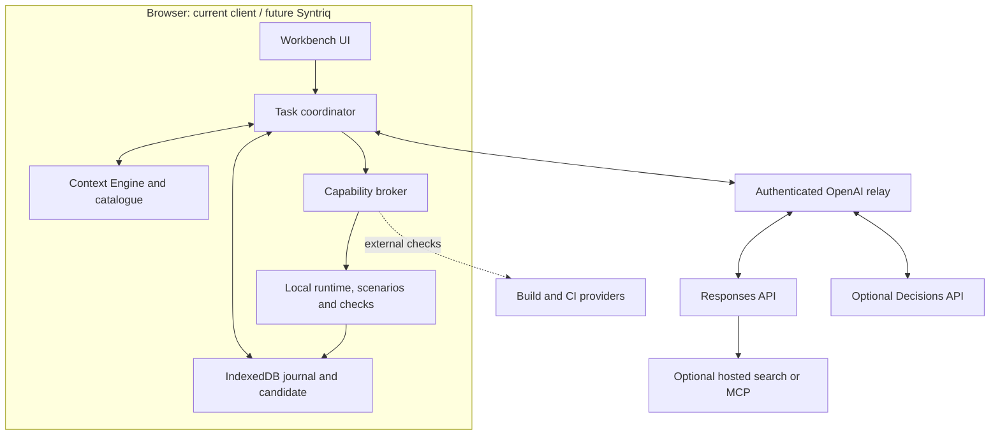
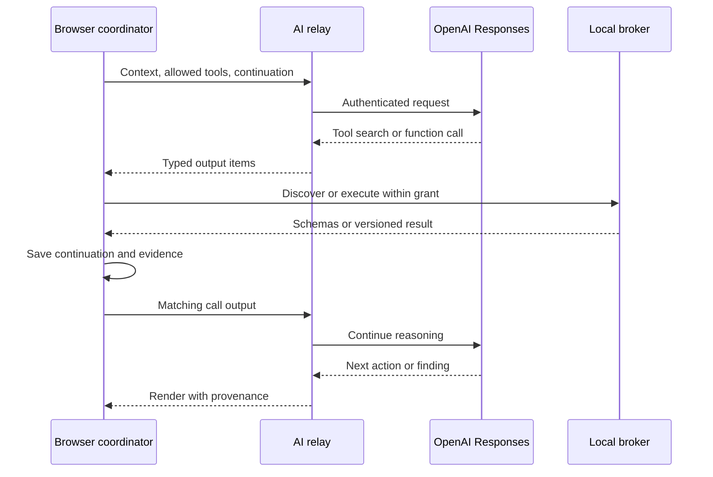

# OpenAI API integration for the browser engineering workbench

**Status:** Architecture and integration plan, 2026-10-13. No live API integration, relay, paid request or OpenAI deployment was performed. Inspected baseline: `5564c11b6b7aefe44cf9f1230b00073d5c4868d7`. The repository search found no existing OpenAI API adapter.

**Primary target: OpenAI APIs.** This binds the [generic context architecture](ai-context-architecture.md) and [engineering workbench](engineering-workbench-architecture.md) to OpenAI capabilities and supersedes their provider-selection examples. Syntriq remains the intended separate host; the current browser client is the implementation environment.

## 1. Decision and placement

Use Responses for the main reasoning/tool loop, strict function tools for browser capabilities, client-executed tool search for discovery, Structured Outputs for plans, and prompt caching/compaction for efficiency and continuity. Evaluate OpenAI Decisions before introducing Jev for narrow classifications. The domain runtime and independent tests remain the authority for software behavior.

The browser owns source selection, coordination, candidate edits, simulation, evidence and resumable state. A small authenticated relay supplies the API credential and enforces service limits. Use an existing gateway or a small service; no domain backend or custom database engine is required.



Our valuable execution environment is the browser application and its reusable tools. Responses lets the host own that loop. The Agents SDK packages orchestration inside an application; the managed Agents API owns durable sessions and a Codex harness in OpenAI's service [O1, O2]. The managed path relocates responsibilities the user currently wants in the browser, so it is an optional future provider.

## 2. Capability map

Documented availability does not establish this project's access or support for every combination. Pin model and SDK versions and test the selected feature set before enabling a live adapter.

| Our component | OpenAI surface | Integration |
|---|---|---|
| Reasoning adapter | `POST /v1/responses` | Scoped context in, typed output items back through relay |
| Browser capability broker | Strict function tools [O3] | Invoke local services and return `function_call_output` |
| Tool discovery | `tool_search`, client execution [O4] | Browser chooses trusted schemas by application, phase and grant |
| Plan/review renderer | Structured Outputs, `text.format` [O5] | Typed changes, findings and evidence references |
| Repeated context | Prompt cache controls [O6] | Stable prefixes with measured cache read/write usage |
| Task continuation | Item history, response chains, Conversations [O7] | Browser-owned history first; hosted state optional |
| Context reduction | Responses compaction [O8] | Opaque continuation separate from readable journal |
| Narrow judgments | `POST /v1/decisions` [O9] | Optional classification/ranking after local filtering |
| Research | Hosted `web_search` [O10] | Preserve source annotations in the UI |
| Uploaded documents | Hosted `file_search`/vector stores [O11] | Optional approved corpus; current source overlay stays local |
| External providers | MCP [O12] | Explicit choice of host-brokered or OpenAI-hosted execution |
| Batch orchestration | Programmatic Tool Calling [O13] | Optional hosted code for bounded read/aggregation stages |
| Frequent continuation | Responses WebSocket mode [O14] | Later transport optimization through relay |
| Agent evaluation | Traces, graders, datasets and eval runs [O15] | Tool-selection and task-quality measurement |

Keep optional hosted tools disabled unless the task needs them. A small initial tool set can complete the first end-to-end slice.

## 3. Authentication and minimal relay

The browser must not receive our service's OpenAI project key. OpenAI documents API-key authentication and secret management [O16]. An embedded shared key is not the deployment design.

Proposed application endpoints, distinct from OpenAI endpoint names:

| Endpoint | Responsibility |
|---|---|
| `POST /ai/responses` | Authenticate, check allowed model/features/budget, forward and stream events |
| `POST /ai/compact` | Compact the selected continuation window when enabled |
| `POST /ai/decisions` | Optional bounded judgment requests |
| `GET /ai/capabilities` | Deployment's allowed model profiles, features and connection status |

The relay chooses credentials and upstream destinations. It enforces identity, request size, concurrency, spend limits and permitted hosted tools/MCP destinations. Use existing identity/gateway facilities where available. An origin check alone is not authorization, and this must not be an unrestricted proxy. Distributed quota enforcement can use existing gateway counters rather than business storage.

Pass through citation annotations, usage, response IDs and typed items. Redact secrets from logs. A stateless HTTP relay needs no workspace database. Durable remote jobs or cross-device collaboration are separate decisions.

Realtime offers ephemeral credentials for browser/mobile connections [O17]. Do not assume these authorize arbitrary Responses features. Voice can later use a separate adapter.

## 4. Catalogue to callable capabilities

Generate the catalogue from contracts, source hashes, dependencies, requirements and acceptance evidence. Load a curated engineering source bundle or retrieve authorized blobs explicitly. OpenAI does not automatically inspect our repository or IndexedDB.

| Group | Proposed operations | Execution |
|---|---|---|
| Context | `context_catalog`, `context_search`, `context_read`, `context_related` | Local source/index worker |
| Candidate | `candidate_inspect`, `candidate_propose_change`, `candidate_apply_change` | Overlay with revision/hash checks |
| Model | `model_compile_supported`, `model_capability_report` | Extracted pure compiler; unsupported builds blocked/external |
| Scenarios | `scenario_list`, `scenario_generate`, `scenario_run` | Existing generators/runtime through adapters |
| Evidence | `evidence_read`, `evidence_compare`, `evidence_coverage` | Findings and requirement links |
| Research/release | Provider-specific search/build/review operations | Hosted tools, MCP and CI/repository providers |

These names are proposals. Group related tools into namespaces where supported, with mappings to transport-neutral internal IDs. Tool search finds actions; context search finds source evidence.

Arguments include data references and expected versions. The host supplies the actual principal, grant, workspace and invocation identity. The model cannot authorize itself by sending `approved: true`.

Results use our envelope: `status`, `candidateDigest`, `workspaceRevision`, `data`, `evidenceRefs`, `unsupported`, `truncated`, `continuation`. A scenario returns relevant assertions and replay inputs, with full traces behind local references. Validate both arguments and results. Strict mode constrains shape [O3]; business validity still comes from our services and tests.

## 5. Execution and streaming



| Returned item | Host behavior |
|---|---|
| `tool_search_call` | Search scoped registry; return `tool_search_output` with matching `call_id` |
| `function_call` | Wait for complete arguments, validate and invoke broker; return correlated result |
| Hosted search/file/MCP result | Record evidence; do not repeat the hosted operation locally |
| MCP approval request | Resolve under existing grant/policy; pause only for missing authorization |
| Reasoning or compaction | Preserve opaque continuation; never treat it as application evidence |
| Message/structured result | Handle progress, final output, refusal or incomplete status explicitly |
| Unknown contract/item | Stop with a compatibility finding instead of silently dropping state |

Never apply partial streamed JSON. Journal operation IDs before mutation. After network failure or reload, reconcile completed calls before retrying. The broker serializes candidate writes even if a model produces multiple requests. Bound steps, output size, time and token spend; cancellation reaches relay and workers.

API completion is not application verification. A change is verified only by current evidence for its actual candidate. A model cannot transfer an old passing trace to a new revision.

## 6. State, memory and compaction

Keep two separate records:

- **Engineering journal:** goals, constraints, accepted plans, source/evidence references, failed attempts and pending work. Useful without OpenAI.
- **OpenAI continuation:** replayable output items, call correlations, assistant phase, encrypted reasoning and compaction. Provider-specific continuity, not a knowledge catalogue.

Default to browser-owned item history and `store: false`. Current stateless Responses return encrypted reasoning by default. Preserve replayable items using the official SDK conversion helper or an equivalently tested serializer [O18]. Never reduce the conversation to `output_text`. On model/provider change, rebuild from readable records and fresh evidence rather than assuming opaque state is portable.

Response-ID chains and Conversations are optional hosted-state patterns [O7]. Choose one continuation mode; do not combine full manual replay with a chain and duplicate history. `store: false` alone neither enables Zero Data Retention nor removes all provider retention [O19].

Compaction supports automatic thresholds and a standalone endpoint. Preserve the standalone result as the complete next context window [O8]. Our journal independently retains acceptance criteria and unresolved gaps. Source retrieval and expected-revision checks still establish freshness after compaction.

Append newly selected evidence with source versions. Mark old excerpts superseded after a source edit. Reject stale writes even if the model repeats them. Compact or rebuild at stable phase boundaries when obsolete context obscures the task.

## 7. Discovery and caching

Client-executed tool search fits our application-dependent registry. Return pinned definitions allowed by the current task. Hosted discovery with deferred tools is another option for a known inventory. Discovered definitions are appended later in model context [O4].

Assemble these segments:

| Segment | Contents | Revision |
|---|---|---|
| Platform primer | Engineering boundaries, tool conventions and verification policy | Engineering-kit version |
| Application primer | Pack identity, component map and relevant support limits | Pack/catalogue version |
| Task update | Goal, expected revision, accepted plan and missing evidence | Append when changed |
| Working evidence | Selected source passages, diff and tool results | Source hashes and candidate identities |

The current GPT-5.6-and-later cache contract uses `prompt_cache_options` and explicit `prompt_cache_breakpoint` markers. Earlier models use different controls. A matching prefix still needs an eligible cache boundary; measure actual reads and writes [O6].

Our first profile uses implicit caching for the growing conversation plus an explicit boundary after the reusable primer. Compare explicit-only mode for unrelated requests with changing suffixes. Keep tool ordering stable, separate workspace cache accounting, and put volatile task metadata later. Never pad irrelevant content just to qualify for caching. These are proposed adapter settings, not measured performance results.

Browser parse/index/result caches continue to invalidate by content and dependency versions. A cloud cache hit cannot establish that a catalogue is current. Optimize verified task success and total cost, not hit rate alone.

## 8. Request sketch

Conceptual wire example for the relay; not installed or tested integration code. Check deployment access and selected model compatibility before enabling it.

```javascript
const request = {
  model: "gpt-6.1-sol",
  store: false,
  stream: true,
  parallel_tool_calls: false,
  reasoning: { effort: "medium", context: "all_turns" },
  prompt_cache_options: { mode: "implicit" },
  input: [
    {
      role: "developer",
      content: [{
        type: "input_text",
        text: trustedPlatformPrimer,
        prompt_cache_breakpoint: { mode: "explicit" }
      }]
    },
    { role: "user", content: JSON.stringify(taskContextPacket) }
  ],
  tools: [{
    type: "function",
    name: "context_read",
    description: "Read a scoped source at its expected content hash.",
    strict: true,
    parameters: {
      type: "object",
      properties: {
        sourceId: { type: "string" },
        expectedHash: { type: "string" }
      },
      required: ["sourceId", "expectedHash"],
      additionalProperties: false
    }
  }]
};
// Browser sends through the authenticated relay, without a project API key.
```

The packet contains source data and is not promoted to trusted developer instructions. The primer comes from host configuration. A tool result is correlated as follows:

```javascript
const outputItem = {
  type: "function_call_output",
  call_id: completedCall.call_id,
  output: JSON.stringify(validatedBrokerResult)
};
```

Append it after preserved model output in the chosen continuation mode. The result comes from real execution, not the model's proposed answer. For plans/reviews, use a separate strict `text.format` schema for findings, affected requirements, references and unrun checks [O5]. Handle refusal/incomplete output before consuming structured values.

## 9. Decisions before Jev

At the research date, Decisions is documented as public beta with `gpt-6-luna`. It accepts text/image evidence and typed predicate, choice and score questions [O9]. Account access and quality on this platform have not been tested.

Place it behind `DecisionProvider.evaluate`. First experiment: route a request toward source inspection, scenario replay or research using locally shortlisted options. Include an uncertain/none outcome. Exact symbol lookup and ordinary conditions stay deterministic.

Compare false routes, abstentions, task success, latency and cost with deterministic routing and the main model. Keep it disabled if it adds cost without benefit. Jev may later implement the same interface for comparison; it is not required.

Judgments never replace billing arithmetic, temporal comparisons, permission checks, capability support or release gates. Set thresholds using labelled held-out cases rather than treating confidence as a universal correctness guarantee.

## 10. Retrieval, MCP and optional cloud execution

**Local source retrieval:** exact/lexical/dependency search in a worker, exposed through function tools. Optional local embeddings can extend it. New source edits are immediately visible through the candidate overlay.

**Hosted File Search:** uploaded documents, semantic/keyword retrieval and managed vector stores [O11]. Suitable for approved reference manuals. Track index readiness and file/source metadata. A hosted document version must not silently override a newer local source.

**Hosted Web Search:** research within Responses [O10]. Preserve clickable source annotations. Research claims become reviewed evidence, not automatically accepted requirements.

**MCP:** OpenAI can execute a configured remote MCP tool, or our browser coordinator can invoke a provider through its broker after an ordinary function request. Choose one owner per call. OpenAI supports HTTP MCP transports [O12]. Secure MCP Tunnel can reach private servers using a separate tunnel client [O20]; it does not automatically expose functions in a browser tab.

**Programmatic Tool Calling:** generated orchestration runs in OpenAI's hosted V8 runtime; client-owned tools still run in our application [O13]. Leave it disabled initially. Later permit bounded read/aggregation stages when measured useful. Keep candidate writes as explicit broker calls. This is a cloud execution exception to the browser preference; do not evaluate generated code in the application origin.

**WebSocket mode:** optional optimization for repeated model/tool round trips [O14]. The relay owns the upstream connection. Browser checkpoints remain necessary for disconnect/recovery.

Python/SHACL, CI and real browser automation remain external checks. Optional OpenAI code execution is another provider, not an automatic replacement for the independent oracle or exact-commit release evidence.

## 11. Runtime choices

| Option | Fit | Decision |
|---|---|---|
| Responses plus our coordinator | Browser owns workflow, candidate and tools | Primary path |
| Agents SDK | Packaged turns, handoffs and tracing in an application runtime | Evaluate if it removes real plumbing; one owner for the loop. Bundle-test browser compatibility of selected features |
| Managed Agents API | Durable external jobs, managed recovery and optional sandbox | Future provider for work outside the browser |

The managed Agents API currently documents US-only residency and no ZDR [O2]. Its key architectural difference here is cloud ownership of agent execution. That can be selected later without moving our domain runtime.

Start with one coordinator and serial candidate writes. Researcher/modeller/reviewer can be tool/prompt profiles. Add independent read-only branches only when useful; merge through evidence references and rerun affected checks.

## 12. Delivery and evaluation

| Step | Existing phases | Deliverable and gate |
|---|---|---|
| OA1 | E1/C1 | Registry, OpenAI schema projection, scripted adapter; no unknown capability or browser secret |
| OA2 | E2/E3/C2 | Local retrieval, overlay and scenario/evidence adapters; reject stale hashes and replay deterministic cases |
| OA3 | E4/C3 | Relay, streaming Responses adapter and item journal; complete one bounded task and handle interrupted/duplicate delivery |
| OA4 | C2/C3/C5 | Tool search, structured plans, caching and compaction; scoped schemas and intact continuity/evidence |
| OA5 | E5 | Research and selected MCP/reference adapters; citations, attribution and visibly pending external checks |
| OA6 | C4 | Decisions and optional retrieval/orchestration upgrades; held-out benefit over baseline |
| OA7 | E6 | Neutral second application/host fixture with the same adapter and contracts |

Live implementation verifies credentials and feature access without exposing secrets. This design and scripted tests require no live key.

Measure application behavior with deterministic/CI checks and agent behavior with source recall, tool choice, task completion and traces/evals [O15]. Record model/profile, prompt/tool versions, candidate digests, call IDs, token/cache usage, latency and seed. Export only selected, appropriately scoped traces.

Failure cases: unknown capability, missing source, stale index, wrong candidate evidence, invalid schema, provider failure, revoked grant, interrupted stream, duplicate write, compaction, model switch and cache miss. Compare cold/warm runs. A convincing explanation alone is not acceptance evidence.

## 13. Official sources

Reviewed 2026-10-13. Research establishes documented capabilities, not a live account test.

| ID | Official OpenAI source |
|---|---|
| O1 | [Agents SDK](https://developers.openai.com/api/docs/guides/agents/sdk) |
| O2 | [Managed Agents API](https://developers.openai.com/api/docs/guides/agents-api/overview) |
| O3 | [Function calling](https://developers.openai.com/api/docs/guides/function-calling) |
| O4 | [Tool search](https://developers.openai.com/api/docs/guides/tools-tool-search) |
| O5 | [Structured Outputs](https://developers.openai.com/api/docs/guides/structured-outputs) |
| O6 | [Prompt caching](https://developers.openai.com/api/docs/guides/prompt-caching) |
| O7 | [Conversation state](https://developers.openai.com/api/docs/guides/conversation-state) |
| O8 | [Compaction](https://developers.openai.com/api/docs/guides/compaction) |
| O9 | [Decisions](https://developers.openai.com/api/docs/guides/decisions) |
| O10 | [Web search](https://developers.openai.com/api/docs/guides/tools-web-search) |
| O11 | [File search](https://developers.openai.com/api/docs/guides/tools-file-search) |
| O12 | [MCP](https://developers.openai.com/api/docs/guides/tools-connectors-mcp) |
| O13 | [Programmatic Tool Calling](https://developers.openai.com/api/docs/guides/tools-programmatic-tool-calling) |
| O14 | [WebSocket mode](https://developers.openai.com/api/docs/guides/websocket-mode) |
| O15 | [Agent evaluation](https://developers.openai.com/api/docs/guides/agent-evals) |
| O16 | [Production practices](https://developers.openai.com/api/docs/guides/production-best-practices) |
| O17 | [Realtime](https://developers.openai.com/api/docs/guides/realtime) |
| O18 | [Reasoning and stateless continuity](https://developers.openai.com/api/docs/guides/reasoning) |
| O19 | [Data controls](https://developers.openai.com/api/docs/guides/your-data) |
| O20 | [Secure MCP Tunnel](https://developers.openai.com/api/docs/guides/secure-mcp-tunnels) |
